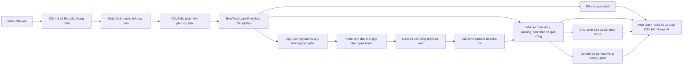
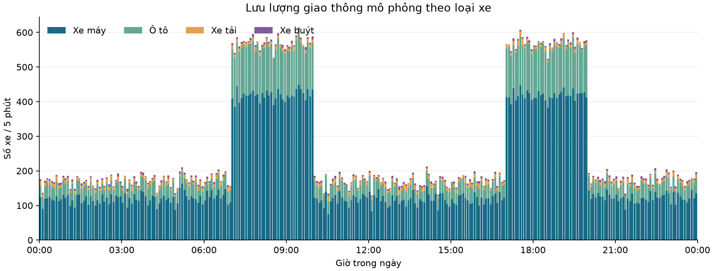
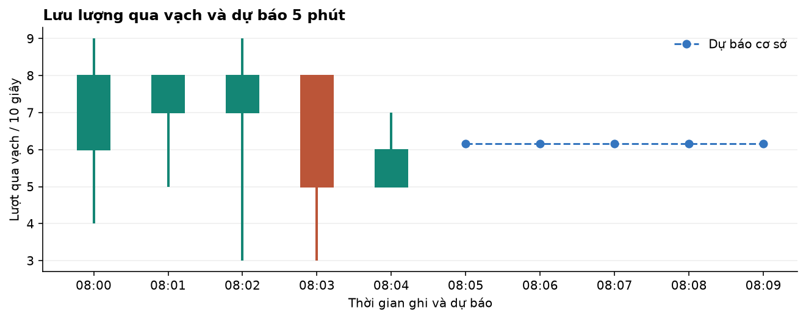
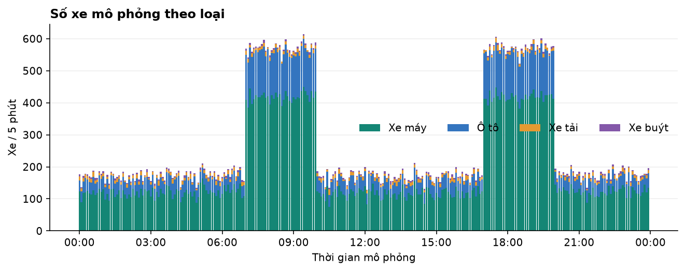
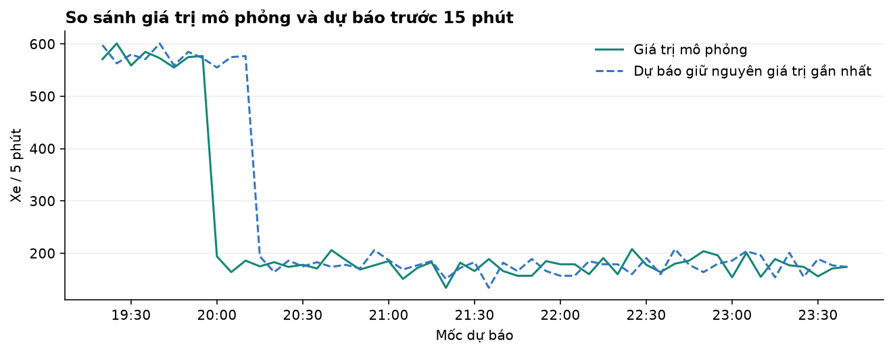

# Hệ thống giám sát và dự báo giao thông

Đồ án xây dựng hệ thống giám sát giao thông hỗn hợp tại Việt Nam theo thời gian thực. Bài toán tập trung vào đường có nhiều xe máy, phương tiện đi sát nhau và thường bị che khuất. Một lượt phát hiện và theo dõi xe cung cấp dữ liệu cho đếm xe, cảnh báo hành vi và dự báo. Bản demo hiện tại chạy trên video đường phố ghi sẵn. Bảng điều khiển chính nằm tại [app/app.py](app/app.py).

## Phạm vi đồ án

| Hạng mục | Phạm vi hiện tại |
| --- | --- |
| Nguồn video | Mỗi phiên xử lý một nguồn. Video ghi sẵn đọc trực tiếp từ đường dẫn máy, phát theo nhịp nguồn từ 0:00 và tránh giới hạn kích thước của bộ tải tệp trình duyệt. Có hỗ trợ RTSP/HTTP và webcam. |
| Phát hiện và theo dõi | YOLOv8s `best_v2.pt` và ByteTrack theo dõi xe máy, ô tô, xe tải và xe buýt. App giảm kích thước ảnh suy luận trong khung tối đa 640 × 384, ưu tiên CUDA/FP16 khi PyTorch hỗ trợ, và dùng CPU/FP32 khi không có CUDA. |
| Lấy mẫu thời gian thực | Chọn bỏ 0–3 khung sau mỗi khung được chọn hoặc dùng **Tự động**. Bộ đệm giữ tối đa một khung chờ và ưu tiên khung mới nhất khi xử lý chậm. Dashboard hiển thị FPS thực, độ trễ P95, số khung chủ động bỏ và số khung rơi do quá tải. |
| Đếm xe | Đếm lượt qua vạch theo hướng, số xe hiện diện, số xe dừng và số xe parking theo vùng. Thống kê lượt đi từ cổng vào tới cổng ra khi hồ sơ camera có cấu hình cổng. |
| Cảnh báo | Kiểm tra đi ngược chiều theo hướng đã cấu hình, đổi hướng đột ngột (**Dangerous** trên dashboard) và nhanh/chậm bất thường so với các xe gần đó cùng loại, cùng vùng, cùng hướng. Các cảnh báo dùng để xem lại bằng chứng. |
| Ngoại lệ parking | Người dùng vẽ và khai báo đa giác lề đường `parking_zones` bằng tọa độ ảnh. Xe phải duy trì trạng thái dừng trong vùng trong ít nhất 3 giây để được gắn **PARKING**. Hệ thống trì hoãn cảnh báo đổi hướng ở lề và loại cảnh báo chờ nếu xe được xác nhận parking. |
| Dự báo | Tab realtime cập nhật mỗi phút, dự báo số xe hiện diện theo vùng sau 5 phút bằng trung bình tối đa 60 giây quan sát gần nhất. MAE realtime chỉ tính trên CSV nhãn đếm độc lập khớp mốc đích và vùng. |
| Bằng chứng | Mỗi phiên lưu `violations.csv` và clip H.264 theo ID xe bằng CPU, kể cả khi YOLO chạy GPU. CSV có đường dẫn và trạng thái xuất clip. Dashboard cho xem đường dẫn và tải tệp khi phiên kết thúc. |
| Giao diện | **Thời gian thực** là luồng video chính, kèm **Lưu lượng lịch sử**, **Cảnh báo đã ghi**, **Thử nghiệm dự báo** và công cụ đề xuất cổng từ quỹ đạo. **Phân tích CSV** là tab riêng cho dữ liệu qua vạch. |
| Đánh giá | Có benchmark CPU/GPU, so sánh frame skip, chấm sự kiện theo đúng xe, IDF1 trên các khung có nhãn, sai số đếm và so sánh dự báo với nhãn độc lập. Kết quả và giới hạn nằm ở phần **Đánh giá hệ thống**. |

## Chạy bảng điều khiển tích hợp

Xem [kịch bản trình diễn realtime](docs/DEMO.md) để chạy clip mẫu và tải bằng chứng cảnh báo.

Dùng Python 3.11 và chạy các lệnh sau trong PowerShell từ thư mục dự án (D:/code/DATN/person_b). Nếu đã có môi trường hoạt động, hãy dùng trình thông dịch Python của môi trường đó và bỏ qua bước cài đặt. Để suy luận trên GPU, cài bản PyTorch tương thích với cấu hình NVIDIA trước khi cài các thư viện của ứng dụng. Xem [hướng dẫn cài đặt trong gói bàn giao thị giác máy tính](data/goi_ban_giao_B/README.md).

```powershell
python -m venv .venv
.\.venv\Scripts\python.exe -m pip install -r requirements.txt -r data/goi_ban_giao_B/requirements.txt
.\.venv\Scripts\python.exe -m streamlit run app/app.py
```

Mở URL Streamlit hiển thị. Trong tab **Thời gian thực**, chọn **Đường dẫn video trên máy**, dán đường dẫn tệp, chọn mức **Bỏ qua khung hình**, rồi bấm **Bắt đầu xử lý thời gian thực**. Bạn cũng có thể chọn video demo đi kèm. Ứng dụng dùng trọng số `data/goi_ban_giao_B/models/best_v2.pt`.

Đường dẫn video tương đối được tính từ thư mục dự án D:/code/DATN/person_b. Nếu video ở thư mục khác, đặt `TRAFFIC_VIDEO_DIR` trỏ đến thư mục chứa video trước khi khởi động:

```powershell
$env:TRAFFIC_VIDEO_DIR = 'D:\traffic-videos'
.\.venv\Scripts\python.exe -m streamlit run app/app.py --server.address=127.0.0.1
```

Để demo nhanh, chọn [đoạn video 14 giây](evals/runs/demo-window-source/demo_42s_56s.mp4), dán [cấu hình demo](evals/demo_profile.json) vào **Vùng đo và ngưỡng cảnh báo**, rồi chọn **Bỏ 3 khung**. Với video khác, chuẩn bị JSON theo kích thước khung hình nguồn. Khi chưa có cấu hình, app đếm xe hiện diện trên toàn khung và dùng vạch đếm ngang mặc định.

| Trường JSON | Ý nghĩa |
| --- | --- |
| `frame_size`, `zones` | Kích thước ảnh nguồn và các đa giác vùng đo theo pixel. |
| `directions` | Vectơ hướng đi hợp lệ trên ảnh cho từng vùng. Chỉ khai báo sau khi xác minh hướng lưu thông. |
| `parking_zones` | Đa giác lề đường do người dùng đánh dấu. |
| `homography` | Ma trận 3 × 3 biến đổi pixel sang tọa độ mặt đường tính bằng mét để ước tính km/h. Tốc độ mặc định tính bằng px/s. |
| `entry_gates`, `exit_gates` | Đa giác cổng vào và ra để ghi lượt di chuyển. |

## Quy trình xử lý của hệ thống



1. **Giải mã và phát hiện.** Ứng dụng lấy mẫu theo chế độ đã chọn, giảm kích thước ảnh trước suy luận rồi quy đổi hộp bao về tọa độ ảnh gốc. Mỗi phiên khởi động mô hình và có trạng thái tracking riêng.
2. **Theo dõi và đếm xe qua vạch.** ByteTrack liên kết các phát hiện qua nhiều khung hình. Hệ thống ghi tối đa một lượt qua vạch cho mỗi ID và xác định hướng dựa trên vị trí trước và sau khi qua vạch.
3. **Đếm xe hiện diện theo vùng.** Hệ thống dùng trung điểm cạnh dưới của hộp bao để xác định xe thuộc đa giác nào. Số xe trong vùng bao gồm cả xe đang dừng. Ứng dụng phân tích mọi khung hình đã xử lý và xuất mẫu đầu tiên của mỗi giây video.
4. **Sàng lọc sự kiện.** Realtime dùng hướng hợp lệ theo vùng cho cảnh báo ngược chiều. Tốc độ tương đối dùng trung vị và MAD của các xe đối chiếu. Dangerous dựa trên góc đổi hướng từ 55° giữa hai đoạn quỹ đạo đang chuyển động trong khoảng một giây. Khi có vùng parking, hệ thống giữ cảnh báo rẽ ở lề để xem xe có dừng hẳn ở đó hay không.
5. **Đếm lượt di chuyển giữa các cổng.** Khi đã cấu hình các đa giác cổng vào và cổng ra, ứng dụng ghi một lượt khi xe đi vào cổng vào, rời cổng đó rồi đi vào cổng ra. Thẻ đề xuất cổng đọc tệp CSV quỹ đạo do YOLO và ByteTrack tạo trong một lần xử lý video trước đó. Thẻ này dùng K-Means để phân cụm điểm đầu và điểm cuối của quỹ đạo. Tải xuống và kiểm tra các cổng trước khi áp dụng.
6. **Hiển thị và xuất dữ liệu.** Dashboard hiển thị video có chú thích, số đo, cảnh báo và dự báo. Worker ghi mẫu vùng, lượt qua vạch, lượt qua cổng, cảnh báo và dự báo trong `telemetry.jsonl`. CSV cảnh báo và clip theo ID nằm trong thư mục của phiên.

Xem [cấu trúc cấu hình camera và các tham số mặc định](docs/TRAFFIC_ANALYTICS.md).

## Lựa chọn mô hình và thuật toán

| Bài toán | Lựa chọn | Lý do và tiêu chí so sánh |
| --- | --- | --- |
| Phát hiện phương tiện | YOLOv8s với trọng số best_v2.pt, IoU và NMS | Checkpoint bốn lớp đã tích hợp với bảng điều khiển và camera demo. IoU đo độ chồng lấp, còn NMS giảm hộp phát hiện trùng. |
| Theo dõi | ByteTrack với bộ lọc Kalman và ghép theo IoU | Tận dụng phát hiện độ tin cậy thấp để nối quỹ đạo khi xe bị che khuất một phần. Duy trì ID giúp tránh đếm lại. Phương án hiện tại có ít bước suy luận hơn khi so với cách bổ sung mô hình nhận dạng lại phương tiện. |
| Đếm qua vạch và theo vùng | Kiểm tra đổi phía qua vạch và kiểm tra điểm trong đa giác | Kiểm tra hai phía nhận ra lượt qua dù khung đã lấy mẫu bỏ qua vị trí đúng trên vạch. Trung điểm cạnh dưới hộp bao xấp xỉ chân xe, giúp gán xe vào vùng mặt đường phù hợp hơn tâm hộp. |
| Vận tốc và xe dừng | Bình phương tối thiểu, biến đổi phối cảnh khi đã hiệu chỉnh và ngưỡng duy trì | Khớp nhiều quan sát giảm ảnh hưởng của rung hộp bao so với lấy chênh lệch hai khung. Biến đổi phối cảnh cho phép đổi ra km/h trong vùng hiệu chỉnh. Thời gian duy trì loại bớt các trường hợp giảm tốc thoáng qua. |
| Đi ngược chiều | So sánh vectơ hướng và dùng ngưỡng duy trì | Hướng hợp lệ được gắn với làn hoặc vùng, phù hợp hơn quy tắc dựa vào một hướng chung trên ảnh. Bộ phát hiện gốc theo hình học Cam5 dùng hai ngưỡng góc trong gói bàn giao. |
| Tốc độ bất thường | Trung vị và MAD của nhóm xe gần nhau, cùng loại và cùng hướng | Trung vị và MAD ít bị chi phối bởi một vài tốc độ cực đoan hơn trung bình và độ lệch chuẩn. Ngưỡng điều chỉnh theo mức tốc độ và độ phân tán thực tế của nhóm. |
| Đề xuất cổng | K-Means riêng cho đầu và cuối quỹ đạo | Cụm điểm giúp xác định nhanh vị trí xe thường xuất hiện hoặc rời vùng quan sát. Người dùng kiểm tra lại vì mất dấu cũng có thể tạo cụm điểm cuối giữa đường. |
| Dự báo | Phương pháp cơ sở trên dashboard, GRU trong thử nghiệm | Trung bình gần đây và tốc độ qua vạch quan sát được có thể sử dụng ngay. GRU được so với các phương pháp cơ sở theo MAE ở từng tầm dự báo. |

## Thuật toán và công thức

### Phát hiện và theo dõi

Với mỗi khung hình lấy mẫu $I_t$, YOLO trả về hộp bao $b=(x_1,y_1,x_2,y_2)$, lớp dự đoán $c$ và độ tin cậy $s$. Độ chồng lấp giữa hai hộp được đo bằng tỷ lệ diện tích giao trên diện tích hợp, $\operatorname{IoU}(a,b)=\frac{\lvert a\cap b\rvert}{\lvert a\cup b\rvert}$. Trong quá trình suy luận, thuật toán khử cực đại (NMS) dùng độ chồng lấp và độ tin cậy để loại bỏ các phát hiện trùng.

ByteTrack dùng bộ lọc Kalman để dự đoán vị trí tiếp theo của mỗi quỹ đạo, rồi ghép hộp dự đoán với các phát hiện hiện tại. Thuật toán ghép các phát hiện có độ tin cậy cao trước, sau đó dùng các phát hiện có độ tin cậy thấp hơn để khôi phục các quỹ đạo chưa ghép. Chi phí ghép theo hình học bắt đầu từ $1-\operatorname{IoU}$ và có thể kết hợp độ tin cậy theo cấu hình. ID quỹ đạo liên kết các quan sát theo thời gian. Tệp CSV lưu ID, thời điểm và tọa độ hộp bao.

**Vì sao dùng IoU?** IoU bằng 0 khi hai hộp không chồng nhau và bằng 1 khi chúng trùng khít. Chia diện tích giao cho diện tích hợp chuẩn hóa độ chồng lấp về thang từ 0 đến 1, giúp so sánh các hộp có kích thước khác nhau. NMS dùng IoU để nhận biết các phát hiện có thể mô tả cùng một xe. ByteTrack dùng $1-\operatorname{IoU}$ vì bài toán ghép ưu tiên chi phí nhỏ và hai hộp càng khớp thì chi phí này càng thấp.

**Ví dụ tính IoU.** Tọa độ $(x_1,y_1)$ và $(x_2,y_2)$ là góc trên trái và dưới phải, tính bằng pixel. Chiều rộng phần giao bằng mép phải nhỏ hơn trừ mép trái lớn hơn, chặn dưới tại 0. Tính chiều cao tương tự rồi nhân hai kích thước. Hai hộp $(0,0,10,10)$ và $(4,0,14,10)$ có diện tích 100 px² mỗi hộp và phần giao 60 px². Diện tích hợp là $100+100-60=140$ px² vì phần giao chỉ được tính một lần. IoU bằng $60/140\approx0.429$, nên chi phí ghép theo hình học là $1-0.429\approx0.571$.

### Đếm qua vạch, xe hiện diện và xe dừng

Với xe $i$, hệ thống lấy trung điểm cạnh dưới của hộp bao làm điểm xấp xỉ tiếp xúc mặt đường, $p_i(t)=\left(\frac{x_1+x_2}{2},\,y_2\right)$. Với vạch ngang $y=L$, xe đi xuống qua vạch nếu $y_{t-1} \lt L \le y_t$ và đi lên nếu $y_t \lt L \le y_{t-1}$. Bộ đếm tích hợp ghi tối đa một lượt qua vạch cho mỗi ID đủ điều kiện.

Với đa giác $Z$, số xe hiện diện tại thời điểm $t$ được tính như sau.

$$
N_Z(t)=\sum_{i\in\mathcal{T}(t)}\mathbf{1}[p_i(t)\in Z]
$$

Trong đó $\mathcal{T}(t)$ là tập các quỹ đạo quan sát được trong khung hình đã xử lý. Nếu điểm nằm trên ranh giới chung, hệ thống gán xe cho vùng khớp đầu tiên. Xe được tính là đang dừng nếu tốc độ trên ảnh thấp hơn $\max(2,0.002H)$ px/s trong ít nhất hai giây, với $H$ là chiều cao khung hình tính bằng pixel.

**Vì sao lấy trung điểm cạnh dưới?** Điểm này xấp xỉ vị trí chân xe trên mặt đường từ hộp bao. Với xe tải cao, tâm hộp có thể nằm phía trên đa giác làn đường trong ảnh dù bánh xe đang ở trong làn. Kiểm tra hai phía của vạch giúp phát hiện lượt qua ngay cả khi lấy mẫu thưa. Ví dụ, xe đi từ $y=98$ sang $y=103$ vẫn được ghi nhận qua vạch $L=100$. Giới hạn một lượt cho mỗi ID giúp tránh đếm lặp khi vị trí ước lượng dao động quanh vạch.

**Vì sao dùng hàm chỉ báo?** Mỗi quỹ đạo đóng góp 1 nếu điểm đại diện nằm trong vùng và 0 nếu nằm ngoài. Nếu 12 xe đang chờ đèn đỏ trong vùng và chưa xe nào qua vạch, số xe hiện diện là 12 và số lượt qua vạch trong khoảng đó là 0. Ngưỡng dừng có mức sàn 2 px/s và tăng theo chiều cao ảnh khi $0.002H$ lớn hơn mức sàn. Yêu cầu duy trì hai giây giúp loại bớt các trường hợp giảm tốc thoáng qua hoặc sai số vị trí giữa các khung hình.

**Ví dụ tính điểm đại diện, số đếm và ngưỡng dừng.** Hộp $(100,80,160,200)$ cho điểm đại diện $(130,200)$ px. Nếu tung độ trước đó là 195 và vạch ở $L=200$, điều kiện $195\lt200\le200$ ghi một lượt đi xuống vì trục ảnh tăng từ trên xuống. Chỉ số $t-1$ chỉ lần quan sát trước của cùng ID. Nếu ba xe có trạng thái trong vùng lần lượt là 1, 0, 1 thì $N_Z(t)=2$ xe. Với ảnh cao 1080 px, ngưỡng dừng là $\max(2,0.002\times1080)=2.16$ px/s. Xe phải duy trì tốc độ ảnh dưới ngưỡng ít nhất hai giây.

### Chuyển động và tốc độ tương đối

Với các quan sát $(t_j,p_j)$ trong một cửa sổ quỹ đạo gần đây, ứng dụng khớp đường thẳng biểu diễn vị trí theo thời gian. Vận tốc là độ dốc ước lượng bằng bình phương tối thiểu theo từng trục.

$$
\hat v=\frac{\sum_j(t_j-\bar t)p_j}{\sum_j(t_j-\bar t)^2}
$$

Tốc độ là $\|\hat v\|$ tính theo px/s. Nếu cấu hình camera cung cấp ma trận biến đổi phối cảnh $M$ từ ảnh sang mặt đường, hệ thống chiếu từng quan sát trước. Với $(u,v,w)^\top=M(x,y,1)^\top$, tọa độ trên mặt đường là $(u/w,v/w)$ tính bằng mét. Khớp đường thẳng trên các tọa độ đó cho tốc độ theo m/s, rồi nhân với $3.6$ để đổi sang km/h. Hệ thống cần ít nhất 0,3 giây lịch sử và xóa lịch sử chuyển động khi có gián đoạn hoặc bước nhảy vị trí bất thường sau khi chuẩn hóa.

Với mỗi xe đủ điều kiện, nhóm so sánh gồm các xe khác ở gần, cùng vùng và cùng loại, có cosin góc giữa hai hướng di chuyển lớn hơn $0.85$. Mặc định cần ít nhất năm xe để so sánh. Gọi $m$ là trung vị tốc độ và $\mathrm{MAD}=\operatorname{median}_j \lvert s_j-m\rvert$ là độ lệch tuyệt đối trung vị. Ngưỡng mặc định là

$$
C=\max\left(1.8m,\;m+\max\left(\delta,\;3.5(1.4826)\mathrm{MAD}\right)\right)
$$

Trong đó $\delta$ là $5$ km/h nếu đã hiệu chỉnh, hoặc $0.01H$ px/s nếu chưa hiệu chỉnh. Mặc định, tốc độ phải duy trì trên $C$ ít nhất một giây để phát cảnh báo. Quy tắc này sàng lọc chuyển động bất thường để đối chiếu với video.

**Vì sao khớp đường thẳng trên nhiều quan sát?** Tính vận tốc từ hai khung hình liên tiếp rất nhạy với rung hộp bao. Bình phương tối thiểu lấy độ dốc trên cả cửa sổ quỹ đạo, giảm ảnh hưởng của từng sai lệch và sử dụng được các mốc thời gian cách nhau không đều. Tốc độ là độ lớn của vectơ vận tốc.

**Vì sao chiếu các điểm xuống mặt đường trước?** Cùng một quãng đường thực, xe gần camera thường dịch chuyển nhiều pixel hơn xe ở xa. Ma trận biến đổi phối cảnh xử lý sự khác biệt này trên mặt đường đã hiệu chỉnh. Phép chia cho $w$ chuyển tọa độ đồng nhất về tọa độ mặt đường.

**Vì sao dùng trung vị và MAD?** Một vài xe chạy rất nhanh có thể kéo trung bình và độ lệch chuẩn lên. Trung vị và MAD ít bị chi phối bởi các giá trị cực đoan, nên phù hợp để mô tả tốc độ điển hình và độ phân tán của nhóm xe đối chiếu.

| Thành phần của ngưỡng | Vai trò |
| --- | --- |
| $1.8m$ | Đặt ngưỡng theo tỷ lệ so với tốc độ điển hình. |
| $m+\delta$ | Đòi hỏi một mức chênh lệch tối thiểu, kể cả khi tốc độ các xe trong nhóm gần như bằng nhau. |
| $m+3.5(1.4826)\mathrm{MAD}$ | Nâng ngưỡng khi tốc độ trong nhóm phân tán. Hệ số $1.4826$ đưa MAD về thang tương đương độ lệch chuẩn khi dữ liệu gần phân phối chuẩn. |

Lấy giá trị lớn nhất buộc tốc độ vượt cả ba mức. Điều kiện duy trì ít nhất một giây giúp giảm cảnh báo do sai số tức thời. Các hệ số $1.8$ và $3.5$ là tham số sàng lọc. Cảnh báo phản ánh mức chênh lệch so với nhóm xe đối chiếu.

**Khai triển phép ước lượng vận tốc.** $t_j$ là thời điểm theo giây, $p_j$ là vị trí và $\bar t$ là trung bình thời điểm. Bình phương tối thiểu chọn vị trí gốc và độ dốc sao cho tổng bình phương sai lệch giữa điểm đo và đường khớp nhỏ nhất. Vì $\sum_j(t_j-\bar t)=0$, tử số có thể dùng trực tiếp $p_j$. Mẫu số dương khi có các thời điểm khác nhau. Với thời điểm $(0,0.5,1)$ giây và điểm $(100,50)$, $(105,52)$, $(110,54)$ px, tử số là $(5,2)$ px·s và mẫu số là $0.5$ s². Vận tốc là $(10,4)$ px/s, còn tốc độ là $\sqrt{10^2+4^2}\approx10.77$ px/s.

**Ví dụ chiếu xuống mặt đường.** Nếu phép hiệu chỉnh theo mét cho $(u,v,w)=(6,10,2)$, điểm chiếu là $(3,5)$ m. Nếu độ dốc sau khi khớp các điểm chiếu là $(3,4)$ m/s thì tốc độ bằng $5$ m/s, tương đương $18$ km/h. Kết quả phụ thuộc vào chất lượng hiệu chỉnh và giả định điểm đại diện nằm gần mặt phẳng đường.

**Ví dụ tính ngưỡng tốc độ bất thường.** Với năm tốc độ đối chiếu 20, 22, 24, 26 và 28 km/h, trung vị là $m=24$ km/h. Các độ lệch tuyệt đối là 4, 2, 0, 2 và 4 km/h, nên $\mathrm{MAD}=2$ km/h. Ba mức lần lượt là $1.8\times24=43.2$, $24+5=29$ và $24+3.5\times1.4826\times2\approx34.38$ km/h. Ngưỡng cuối cùng là $43.2$ km/h. Xe chạy 45 km/h vượt ngưỡng và cần duy trì đủ thời gian để phát cảnh báo.

### Phát hiện đi ngược chiều

Bộ phát hiện gốc trong gói bàn giao Cam5 so sánh độ dịch chuyển $\Delta p$ trong cửa sổ quỹ đạo đã làm mượt với vectơ đơn vị $d$ biểu thị hướng đi dự kiến theo hình học đường đã hiệu chỉnh. Góc giữa hai hướng được tính như sau.

$$
\theta=\arccos\left(\frac{\Delta p\cdot d}{\|\Delta p\|}\right)
$$

Trong các cửa sổ chuyển động đủ điều kiện, góc trên $165^\circ$ bắt đầu một trường hợp nghi vấn và góc trên $135^\circ$ có thể duy trì trường hợp đó. Thời gian duy trì mặc định là 0,6 giây, được quy đổi thành số khung hình đã xử lý. Khoảng cách tới ranh giới, tính nhất quán của chuyển động và chất lượng hộp bao cũng ảnh hưởng đến điều kiện xét. Worker realtime dùng cấu hình hướng theo vùng và kiểm tra tích vô hướng giữa hướng chuyển động và hướng đã cấu hình, đều ở dạng vectơ đơn vị, có nhỏ hơn $-0.85$ hay không. Quy tắc realtime cũng yêu cầu tốc độ tối thiểu và thời gian duy trì (mặc định 1 giây).

**Vì sao dùng góc và hai ngưỡng?** Vì $d$ là vectơ đơn vị, tích vô hướng chia cho độ lớn của $\Delta p$ cho cosin của góc giữa hai hướng. Góc $0^\circ$ tương ứng với cùng hướng, $90^\circ$ là vuông góc và $180^\circ$ là ngược hướng. Ngưỡng $165^\circ$ yêu cầu chuyển động gần như đối nghịch để mở nghi vấn. Ngưỡng $135^\circ$ cho phép duy trì nghi vấn khi hướng dao động nhẹ do đường cong hoặc sai số theo dõi. Quy tắc theo cấu hình camera so sánh trực tiếp tích vô hướng vì với hai vectơ đơn vị, tích này đã là cosin của góc.

**Ví dụ tính góc.** Với hướng hợp lệ $d=(1,0)$ và dịch chuyển $\Delta p=(-3,0)$ px, tích vô hướng bằng $-3$ px và độ lớn dịch chuyển bằng $3$ px. Vì vậy $\cos\theta=-1$ và $\theta=180^\circ$, vượt ngưỡng góc bắt đầu nghi vấn. Nếu $\Delta p=(0,3)$ px, tích vô hướng bằng 0 và góc là $90^\circ$. Phép chia cần dịch chuyển khác 0. Với quy tắc theo cấu hình camera, $\cos\theta\lt-0.85$ tương ứng với góc lớn hơn khoảng $148.2^\circ$.

### Đề xuất cổng và dự báo

Thuật toán đề xuất cổng ngoại tuyến lọc bỏ quỹ đạo không phù hợp và giữ tối đa bảy quan sát ở mỗi đầu. Hệ thống chọn các điểm thuộc dải ngoài rộng một phần sáu của vùng quỹ đạo, rồi phân cụm điểm đầu và điểm cuối riêng. Với mỗi nhóm, K-Means tối thiểu hóa $\sum_j\|p_j-\mu_{a_j}\|^2$, trong đó $a_j$ là cụm được gán và $\mu_{a_j}$ là tâm cụm. Ứng dụng tạo các hình chữ nhật đề xuất từ các cụm để người dùng kiểm tra.

Với mỗi vùng, dự báo realtime dùng trung bình số xe hiện diện gần đây làm ước tính tại thời điểm sau 300 giây. Với $m$ mẫu trong tối đa 60 giây gần nhất, $\widehat N_Z(t+300)=\frac{1}{m}\sum_{j=1}^{m}N_Z(t_j)$. Dự báo lưu lượng qua vạch ở tab CSV dùng số lượt quan sát được mỗi phút nhân với năm.

Trong thử nghiệm mô phỏng, GRU nhận một cửa sổ dữ liệu quá khứ. Lớp đầu ra kết nối đầy đủ ánh xạ trạng thái hồi tiếp cuối cùng thành một vectơ số lượng xe dự báo. Quá trình huấn luyện tối thiểu hóa sai số bình phương trung bình $\frac{1}{n}\sum_{j=1}^{n}(y_j-\hat y_j)^2$ trên số đếm đã chuẩn hóa.

**Vì sao phân cụm điểm đầu và điểm cuối riêng?** Nhiều xe xuất hiện gần cùng một lối vào và mất dấu gần cùng một lối ra. K-Means giảm tổng bình phương khoảng cách từ mỗi điểm đến tâm cụm để tìm những vị trí tập trung. Phân cụm riêng giữ được vai trò của từng đầu quỹ đạo. Người dùng kiểm tra cổng đề xuất vì quỹ đạo cũng có thể kết thúc giữa đường do che khuất hoặc mất ID.

**Vì sao dự báo bằng trung bình gần đây?** Trung bình làm mượt các dao động ngắn, chẳng hạn khi vài xe bị che khuất ở một khung hình. Nếu vùng có trung bình 12 xe trong cửa sổ quan sát, dự báo cơ sở là khoảng 12 xe hiện diện tại mốc sau 5 phút. Con số này tạo một mốc để so sánh với các mô hình phức tạp hơn. Với lưu lượng qua vạch, kết quả biểu thị tổng số lượt trong khoảng dự báo. Ví dụ, 8 lượt/phút tương ứng với dự báo 40 lượt trong 5 phút.

**Vì sao dùng sai số bình phương trung bình cho GRU?** Trong công thức MSE, $y_j$ là giá trị thực và $\hat y_j$ là giá trị dự báo trên cùng thang chuẩn hóa. Bình phương làm cả sai số âm lẫn sai số dương đóng góp dương, đồng thời phạt sai số lớn mạnh hơn. Trên cùng thang đo, sai số 4 đóng góp 16 vào tổng, còn sai số 2 đóng góp 4. Vì vậy, các dự báo lệch nhiều có ảnh hưởng lớn hơn trong quá trình huấn luyện.

**Ví dụ tính tâm K-Means.** Mỗi điểm được gán cho tâm gần nhất, rồi tâm được cập nhật bằng trung bình tọa độ các điểm đã gán. Nếu hai điểm $(10,20)$ và $(14,22)$ px cùng thuộc một cụm thì tâm là $(12,21)$ px. Mỗi điểm đóng góp $2^2+1^2=5$ px² vào hàm mục tiêu, tổng là 10 px².

**Ví dụ tính dự báo.** Nếu các mẫu số xe hiện diện là 8, 10, 12, 14 thì $m=4$ và dự báo bằng $(8+10+12+14)/4=11$ xe tại mốc sau 300 giây. Với $Q$ lượt qua vạch trong $T$ phút, tốc độ quan sát là $Q/T$ lượt/phút, nên dự báo 5 phút là $5Q/T$ lượt. Ví dụ, 24 lượt trong 3 phút cho dự báo 40 lượt trong 5 phút.

**Ví dụ tính MSE.** $n$ là số phần tử dự báo được so với giá trị thực trên cùng thang chuẩn hóa. Hai sai số $-0.2$ và $0.4$ cho $\mathrm{MSE}=(0.04+0.16)/2=0.10$. Trong bảng đánh giá, MAE là trung bình độ lớn sai số sau khi trả dự báo về thang số đếm gốc. MSE dùng để huấn luyện, còn MAE cho biết dự báo lệch trung bình bao nhiêu xe hoặc lượt theo chỉ số đang xét.

## Dữ liệu và dự báo

| Chỉ số | Ý nghĩa |
| --- | --- |
| Lưu lượng qua vạch | Số lượt qua vạch trong mỗi khoảng thời gian, phân theo hướng hoặc loại xe. |
| Số xe hiện diện theo vùng | Số xe quan sát được trong một đa giác tại thời điểm lấy mẫu. Để tính mật độ theo đơn vị diện tích, cần đo diện tích mặt đường. |
| Số ID quan sát được | Số ID khác nhau xuất hiện trong một khoảng thời gian. Một xe có thể được đếm trong nhiều khoảng liên tiếp. |
| Tốc độ phương tiện | Mặc định tính chuyển động trên ảnh theo px/s. Phép biến đổi phối cảnh đã hiệu chỉnh từ pixel sang mét cho phép ước tính km/h trong vùng đường hợp lệ. |

Dự báo realtime dùng số xe hiện diện trung bình trong tối đa 60 giây gần nhất để ước tính số xe tại mốc sau 5 phút. Tab CSV dự báo lưu lượng qua vạch bằng cách giữ nguyên tốc độ qua vạch quan sát được. Hai đầu ra dùng đơn vị khác nhau và được đánh giá riêng.

Thử nghiệm so sánh phương pháp giữ nguyên giá trị gần nhất, dự báo ngây thơ theo chu kỳ, trung bình trượt và GRU trên số đếm mô phỏng. Dữ liệu qua vạch từ video thực dài khoảng 25,7 phút, chưa đủ cho cấu hình dùng 60 phút lịch sử để dự báo 30 phút tiếp theo. Khi chuẩn bị dữ liệu, cần thống nhất camera, vạch đếm, hướng, khoảng lấy mẫu và định nghĩa phép đo. Giữ thông tin về các khoảng chưa đủ thời lượng và các đoạn ghi hình bị gián đoạn. Xem [quy ước dữ liệu](docs/DATA_CONTRACT.md), [tình trạng dữ liệu dự báo](data/forecast_dataset/README.md) và [báo cáo chuẩn bị dữ liệu qua vạch](data/forecast_dataset/cam5_real/report.json).

### Biểu đồ lưu lượng mô phỏng



Mỗi cột biểu diễn một khoảng 5 phút. Chiều cao toàn cột là tổng số xe, còn các phần màu thể hiện số xe máy, ô tô, xe tải và xe buýt. Biểu đồ dùng toàn bộ 288 khoảng trong một ngày từ [tệp dữ liệu mô phỏng](data/mock_traffic_data.csv).

## Biểu đồ minh họa từ dữ liệu mô phỏng

### Lưu lượng qua vạch và dự báo 5 phút



Mỗi nến tóm tắt sáu mẫu đếm 10 giây trong một phút. Hai đầu thân nến là số lượt ở mẫu đầu và mẫu cuối. Hai đầu râu nến là số lượt thấp nhất và cao nhất. Đường nét đứt dự báo năm phút tiếp theo bằng cách giữ nguyên số lượt trung bình trên 10 giây của đoạn ghi mô phỏng. [Dữ liệu lượt qua vạch](data/demo_crossings_5min.csv)

### Số xe theo loại trong ngày



Mỗi cột biểu diễn một khoảng 5 phút. Bốn phần màu là số xe máy, ô tô, xe tải và xe buýt. Chiều cao cả cột là tổng số xe trong khoảng đó. [Dữ liệu số xe mô phỏng](data/mock_traffic_data.csv)

### So sánh dự báo trước 15 phút với dữ liệu mô phỏng



Đường liền là giá trị mục tiêu trong dữ liệu mô phỏng. Đường nét đứt là dự báo của phương pháp giữ nguyên giá trị gần nhất. Mỗi điểm là số xe trong khoảng 5 phút tại mốc dự báo. Khoảng cách giữa hai đường thể hiện sai số theo từng mốc trên dữ liệu mô phỏng. [Kết quả dự báo đã lưu](results/mock_forecast/test_predictions.csv)

Hai bộ CSV mô phỏng cung cấp số đếm tổng hợp và sự kiện qua vạch. Biểu đồ số xe hiện diện theo vùng cần thêm tọa độ xe theo khung hình và cấu hình vùng đo.

## Các bảng dữ liệu trích xuất từ video

Các bảng dưới đây minh họa dữ liệu mà quy trình xử lý tạo ra. Tên cột giữ theo tệp CSV hoặc kết quả xuất của ứng dụng. Các bảng chỉ hiển thị những cột cần thiết để minh họa cách đọc.

### Quỹ đạo phương tiện

Mỗi dòng là một quan sát của một xe tại một khung hình. YOLO phát hiện loại xe và hộp bao. ByteTrack gán `track_id` để nối các quan sát của cùng một xe trong bản ghi. Đây là dữ liệu đầu vào của bước đề xuất cổng ngoại tuyến. [Nhật ký quỹ đạo trích xuất từ video](data/tuan4/data/tracking_log_full.csv)

| frame | time_s | track_id | class | conf | x1 | y1 | x2 | y2 |
| ---: | ---: | ---: | --- | ---: | ---: | ---: | ---: | ---: |
| 0 | 0,0 | 1 | xe_hoi | 0,932 | 1795 | 356 | 1919 | 720 |
| 0 | 0,0 | 2 | xe_may | 0,916 | 995 | 415 | 1150 | 805 |

### Sự kiện qua vạch

Mỗi dòng là một lượt xe qua vạch đếm. `direction` cho biết xe đi về phía camera (`toward`) hay ra xa camera (`away`). Các dòng này được tổng hợp theo thời gian để vẽ biểu đồ lưu lượng. [Tệp sự kiện qua vạch từ video](data/forecast_dataset/cam5_real/crossing_events.csv)

| time_s | track_id | class_name | direction |
| ---: | ---: | --- | --- |
| 3,0 | 5 | motorbike | toward |
| 3,4 | 6 | motorbike | away |

### Số xe hiện diện theo vùng

Mỗi dòng là số xe quan sát được trong một vùng tại thời điểm lấy mẫu. Một xe đang dừng vẫn có thể xuất hiện trong các mẫu liên tiếp. Bảng dưới đây lấy từ kết quả xử lý ngoại tuyến. Bản xuất `zone_counts.csv` trên dashboard còn có cột `stopped` cho số xe được nhận diện là đang dừng. [Mẫu số xe theo vùng](results/cam5_density/samples_1s.csv)

| time_s | zone | xe_may | xe_hoi | xe_tai | bus | total |
| ---: | --- | ---: | ---: | ---: | ---: | ---: |
| 0,0 | toward_side | 1 | 0 | 0 | 0 | 1 |
| 1,0 | toward_side | 1 | 0 | 0 | 0 | 1 |

### Cảnh báo đi ngược chiều

Mỗi dòng ghi thời điểm và ID của xe được gắn cờ. `cao_px` là chiều cao hộp bao theo pixel. Đối chiếu video tại thời điểm cảnh báo để xác nhận chuyển động thực tế. [Nhật ký cảnh báo từ video](data/goi_ban_giao_B/data/wrongway_alerts_final.csv)

| time_s | gio_canh_bao | track_id | loai | cao_px | vung |
| ---: | --- | ---: | --- | ---: | --- |
| 59,3 | 13:42:49 | 164 | xe_hoi | 88 | xa |
| 99,7 | 13:43:29 | 356 | xe_hoi | 195 | gan |

### Mẫu chuyển động, cảnh báo theo vùng và lượt qua cổng

Ba dòng sau minh họa định dạng CSV của quy trình phân tích video ngoại tuyến bằng dữ liệu giả định. Luồng realtime ghi kết quả theo các tệp của từng phiên ở phần dưới.

| Tệp xuất | Ví dụ một dòng | Cách đọc |
| --- | --- | --- |
| `motion_samples.csv` | `time_s=12, track_id=42, zone=approach, speed=36, speed_unit=px/s, quality=ok` | Tốc độ ước tính của xe tại thời điểm lấy mẫu. Cột `quality` cho biết trạng thái của quỹ đạo. |
| `motion_alerts.csv` | `time_s=13, track_id=42, event=relative_speed, speed=36, speed_unit=px/s, peer_median=16, peer_count=6` | Cảnh báo tốc độ tương đối cho xe chạy nhanh hơn nhóm xe so sánh. Tệp này cũng có thể chứa cảnh báo ngược chiều theo cấu hình vùng. |
| `movements.csv` | `time_s=18, track_id=42, entry=north_in, exit=east_out` | Xe đã hoàn tất một lượt di chuyển từ cổng vào đến cổng ra. |

### Tệp của một phiên realtime

| Tệp trong `results/realtime/<phiên>/` | Nội dung |
| --- | --- |
| `telemetry.jsonl` | Mẫu số đếm theo vùng, lượt qua vạch, lượt qua cổng, cảnh báo, dự báo và độ trễ chuẩn bị theo khung. |
| `summary.json` | Thiết bị, thời gian từ đầu nguồn, tổng số khung đã xử lý/bỏ/rơi, FPS, độ trễ và kết quả đối chiếu dự báo nếu có nhãn. |
| `violations.csv` | Thời gian từ đầu video, ID xe, loại xe, vùng, số liệu chuyển động khi có và trạng thái xuất clip. Nhãn Dangerous trên dashboard tương ứng mã `abrupt_turn` trong tệp. |
| `clips/track_*.mp4` | Đoạn bằng chứng có đánh dấu xe gây cảnh báo, mã hóa H.264 bằng CPU. CSV vẫn ghi sự kiện khi hàng chờ bận hoặc xuất clip lỗi. |

## Cấu trúc kho mã

| Đường dẫn | Vai trò |
| --- | --- |
| [`app/`](app/) | Ứng dụng Streamlit tích hợp, bảng điều khiển CSV qua vạch độc lập và các trang thử nghiệm dự báo. |
| [`src/`](src/) | Phân tích theo vùng, đề xuất cổng, tổng hợp CSV và các mô hình dự báo. |
| [`data/goi_ban_giao_B/`](data/goi_ban_giao_B/) | Gói bàn giao thị giác máy tính gồm mô hình phát hiện, quy trình theo dõi, video mẫu và số liệu đã ghi. Bảng điều khiển nạp `src/traffic_pipeline.py` từ gói này. |
| [`scripts/`](scripts/) | Chuẩn bị dữ liệu quỹ đạo và lượt qua vạch, đếm xe theo vùng ngoại tuyến, kiểm tra video nguồn và chạy thử nghiệm dự báo mô phỏng. |
| [`evals/`](evals/) | Benchmark, bộ chấm, nhãn độc lập và kết quả đánh giá. |
| [`docs/`](docs/) | Kịch bản demo, quy ước dữ liệu, cấu hình camera và tài liệu đồ án. |
| [`tests/`](tests/) | Kiểm thử pipeline, tracking, cảnh báo, replay, parking và xuất bằng chứng. |
| [`results/`](results/) | Nhật ký từng phiên realtime và kết quả đánh giá đếm xe, dự báo ngoại tuyến. |

## Lệnh dành cho nhà phát triển

Chạy các lệnh sau từ `D:/code/DATN/person_b` sau khi kích hoạt môi trường Python.

```powershell
python -m unittest discover -s tests
python -m unittest discover -s evals
python scripts/measure_cam5_density.py
python scripts/train_forecast.py --epochs 25
```

Bộ kiểm thử có bài kiểm tra nhanh dùng video mẫu và cần cả tệp trọng số lẫn video đi kèm. Hai tập lệnh lần lượt tạo lại kết quả đếm xe theo vùng ngoại tuyến và kết quả dự báo mô phỏng.

Hệ thống đã được thử với video ghi sẵn phát theo nhịp gốc. Cần đánh giá riêng khả năng xử lý liên tục từ camera trực tiếp, độ chính xác cảnh báo và sai số dự báo trên các video giờ cao điểm chưa dùng trong thử nghiệm.

## Đánh giá hệ thống

Xem [hướng dẫn chạy benchmark](evals/README.md) để đo FPS xử lý, tốc độ bao phủ video và sai số đếm/cảnh báo khi có nhãn đối chiếu.

### Hiệu năng trên máy chạy demo

Phép so sánh gần nhất chạy mỗi chế độ ba lần xen kẽ trên cùng đoạn demo 14 giây, nguồn 60 FPS, RTX 4050 Laptop và cùng hồ sơ camera. Worker dùng YOLOv8s, ByteTrack, phân tích hành vi và xuất clip bằng CPU. P95 đo đến lúc worker chuẩn bị xong kết quả và gửi frame vào bộ xuất bằng chứng. Thời gian hiển thị trên trình duyệt được đo riêng khi cần.

| Chế độ | FPS xử lý trung vị | P95 trung vị | Xe ngược chiều có nhãn | Clip xuất và đọc được |
| --- | ---: | ---: | ---: | ---: |
| Tự động | 14,26 | 94 ms | 2/2 mỗi lần | 12/12 |
| Bỏ 3 khung | 14,83 | 94 ms | 2/2 mỗi lần | 12/12 |

Giữ **Bỏ 3 khung** cho đoạn demo 14 giây. Trên trình duyệt, một lượt chạy với cấu hình đó đạt 12,23 FPS, P95 140 ms và xuất 3 clip. Trên đoạn Cam5 20 giây khác, ma trận CPU/GPU cho thấy chế độ tự động đạt 4,56 FPS và P95 335 ms trên CPU, so với 13,61 FPS và P95 63 ms trên GPU. [Sáu lần chạy cùng clip](evals/runs/demo-mode-comparison/comparison.csv) · [Phiên demo trên trình duyệt](results/realtime/20261117-015511-310676/summary.json) · [Ma trận CPU/GPU](evals/PILOT_RESULTS.md)

#### Phép đo thông lượng ngoại tuyến trước đây

Máy đo dùng AMD Ryzen 5 7235HS, RTX 4050 Laptop 6 GB VRAM và 16 GB RAM. Pipeline dùng YOLOv8s và ByteTrack trên CUDA. Mỗi cấu hình chạy ba lần trên cùng đoạn 12 giây của video 1080p 60 FPS sau khi làm nóng mô hình. Thời gian gồm giải mã, suy luận, theo dõi, phân tích và vẽ chú thích. Phép đo bỏ qua thời gian trình duyệt hiển thị và mã hóa video đầu ra.

| Cấu hình | Khung xử lý | Thời gian trung vị | FPS xử lý trung vị | Tốc độ so với phát |
| --- | ---: | ---: | ---: | ---: |
| Mọi khung hình (stride=1) | 720 | 41,9 giây | 17,2 | 0,29× |
| Một khung trên ba (stride=3) | 240 | 12,8 giây | 18,8 | 0,94× |

Với nguồn 60 FPS, stride=3 cần 20 FPS xử lý để theo kịp tốc độ phát. Các lần đo mất 12,7–17,8 giây ở cấu hình này. Cả hai cấu hình ghi 7 lượt qua vạch trên đoạn thử. Stride 3 trong benchmark ngoại tuyến tương ứng với bỏ 2 khung giữa hai khung được chọn.

### Chất lượng phát hiện, theo dõi và cảnh báo

- **Phát hiện.** Checkpoint demo `best_v2.pt` đạt 59,0% mAP50–95 trên 37 ảnh validation ở kích thước 640, so với 53,4% của checkpoint epoch cuối. Trên 18 ảnh test của bộ dữ liệu lưu sẵn, mAP50–95 là 40,2%. Xe máy đạt 62,5%, xe tải đạt 28,4% và mẫu xe buýt duy nhất bị nhận nhầm thành xe tải. Chưa xác minh mức trùng giữa bộ dữ liệu này và dữ liệu huấn luyện. [Đánh giá checkpoint](evals/DETECTOR_REVIEW.md)
- **Theo dõi và đếm.** Đã chấm IDF1, số lần đổi ID và sai số đếm theo từng chế độ lấy mẫu trên bốn khung Cam5 có nhãn. Báo cáo kèm số khung có dự đoán và số mẫu dùng để tính MAE. [Đánh giá tracking](evals/PILOT_RESULTS.md)
- **Cảnh báo realtime.** Bộ chấm ghép theo loại sự kiện, thời điểm và danh tính xe qua hộp bao được gán nhãn. Đã đối chiếu hai ca ngược chiều và một ca Dangerous. Với nhanh/chậm tương đối, đã đánh dấu quỹ đạo để kiểm tra nhóm xe đối chiếu, chưa có đủ ca sự kiện để tính precision và recall cho từng lớp. [Nhật ký nhãn](evals/labels/ANNOTATION_NOTES.md)
- **Kiểm thử tự động.** Lần chạy đã ghi nhận 23 test ứng dụng và 4 test metrics đạt. Các test gồm clip demo, phát lại từ 0:00, xuất bằng chứng, ngoại lệ parking, nhãn độc lập cho dự báo và cảnh báo đúng xe. [Kiểm thử realtime](tests/test_realtime.py) · [Kiểm thử bộ chấm](evals/test_metrics.py)

### Kiểm thử cảnh báo đi ngược chiều

Kết quả dưới đây thuộc bộ phát hiện trong gói bàn giao, với góc camera cố định và hình học đường đã hiệu chỉnh cho khung hình 1920 × 1080. Bộ phát hiện theo dõi hướng di chuyển của xe theo thời gian và phát cảnh báo khi chuyển động ngược hướng thỏa các điều kiện về góc và thời gian duy trì. Báo cáo bàn giao dùng hai nhóm dữ liệu để trả lời hai câu hỏi khác nhau. [Báo cáo bàn giao](data/goi_ban_giao_B/README.md)

| Chỉ số | Cách kiểm thử và điều kiện đánh giá | Kết quả |
| --- | --- | --- |
| **Tỷ lệ cảnh báo đúng (precision)** | Duyệt thủ công 21 cảnh báo hệ thống đã phát ngoài clip kiểm tra. Đối chiếu từng cảnh báo với video để xác định xe có thực sự đi ngược chiều hay không. | **80,95%** cảnh báo được xác nhận đúng. **19,05%** là cảnh báo sai, tương ứng 4 trường hợp. |
| **Tỷ lệ phát hiện ca thật (recall)** | Trên clip kiểm tra dài khoảng 60 giây có 7 ca đi ngược chiều thực tế theo báo cáo bàn giao. Đối chiếu các ca đó với kết quả phát hiện để xác định ca nào được ghi nhận. | **71,43%** ca đi ngược chiều được phát hiện. **28,57%** bị bỏ sót, tương ứng 2 trường hợp. |

Precision được tính trên các cảnh báo đã phát và được duyệt. Recall được tính trên tất cả ca đi ngược chiều thực tế trong clip kiểm tra. Vì hai tỷ lệ lấy từ hai nhóm khác nhau và số mẫu còn ít, hãy báo cáo riêng từng chỉ số. Cần thêm video được gán nhãn ở các góc camera và điều kiện giao thông khác để đánh giá khả năng áp dụng rộng hơn. Đoạn benchmark 12 giây phục vụ đo tốc độ xử lý và không ghi nhận cảnh báo.

### Kết quả dự báo

Trên Cam5, so sánh dự báo số xe hiện diện sau 5 phút với **9 số đếm độc lập** tại đích. Lịch sử đầu vào lấy từ YOLO/ByteTrack, dữ liệu huấn luyện GRU và cửa sổ kiểm tra được tách theo thời gian.

| Phương pháp | MAE (xe) | RMSE (xe) |
| --- | ---: | ---: |
| Giữ giá trị cuối | 1,89 | 2,03 |
| Trung bình 60 giây | **1,03** | **1,14** |
| GRU | 1,15 | 1,30 |

Dashboard giữ trung bình 60 giây cho dự báo realtime. So sánh này dùng một video và chín nhãn đích, nên cần thêm dữ liệu trước khi thay baseline. [Kết quả từng dự báo](evals/runs/cam5-forecast-pilot/predictions.csv)

#### Thử nghiệm lưu lượng trên dữ liệu mô phỏng

| Phương pháp | MAE sau 5 phút | MAE sau 30 phút |
| --- | ---: | ---: |
| GRU | **25,63** | 70,51 |
| Giữ giá trị cuối | 27,62 | **58,94** |
| Trung bình trượt | 37,56 | 74,08 |

Trên dữ liệu mô phỏng, GRU có MAE thấp nhất trong các phương pháp đã thử ở tầm 5 phút. Phương pháp giữ giá trị cuối có MAE thấp nhất ở tầm 30 phút. Trung bình trượt trong bảng là cấu hình của thí nghiệm mô phỏng. [Kết quả dự báo mô phỏng](results/mock_forecast/metrics.csv)

Dữ liệu qua vạch Cam5 dài khoảng 25,7 phút, có bốn khoảng 5 phút đầy đủ mỗi hướng và chưa tạo được mẫu cho cấu hình 60 phút lịch sử → 30 phút dự báo. Việc đưa GRU lên dashboard cần kết quả tốt hơn baseline trên dữ liệu camera thật giữ riêng theo thời gian. [Báo cáo dữ liệu Cam5](data/forecast_dataset/cam5_real/report.json)

## Chế độ thời gian thực

Tab **Thời gian thực** hỗ trợ đường dẫn video trên máy, clip demo phát theo nhịp gốc, RTSP/HTTP và webcam. Mỗi phiên chạy capture và suy luận trong luồng nền riêng. Bộ đệm giữ tối đa một frame chờ xử lý; khi xử lý chậm, frame cũ được thay bằng frame mới. YOLO được warm-up và đo thời gian suy luận để chọn chu kỳ lấy mẫu; chu kỳ tiếp tục điều chỉnh theo thời gian xử lý thực tế. GPU CUDA được ưu tiên nếu PyTorch hỗ trợ, CPU dùng FP32.

Một lượt tracking cung cấp đầu vào chung cho đếm theo vùng, qua vạch, dừng xe, đổi hướng, tốc độ tương đối, ngược chiều theo directions và lượt qua cổng. Vùng mặc định là toàn ảnh. Để kiểm tra ngược chiều cần JSON directions theo từng vùng; video demo ở chế độ này cũng cần cấu hình hướng. JSON có homography hỗ trợ tốc độ km/h. FPS là số frame đã phân tích mỗi giây thực. Dashboard đếm riêng frame chủ động bỏ khi lấy mẫu và frame rơi khi bộ đệm thay frame cũ.

Độ trễ chuẩn bị kết quả đo từ lúc lấy frame để xử lý theo nhịp nguồn đến khi hoàn tất phân tích, vẽ, resize và chuyển bằng chứng sang bộ xuất clip. Độ trễ camera, mạng, bộ giải mã bên trong và trình duyệt cần được đo riêng bằng nguồn có timestamp đồng bộ. Chu kỳ lấy mẫu thích ứng có thể ảnh hưởng độ chính xác tracking và cảnh báo; cần đánh giá theo từng cấu hình trên video có nhãn.

Nhật ký JSONL được ghi tại results/realtime theo từng phiên, gồm vùng đo, sự kiện và cảnh báo. Nút Dừng kết thúc worker. Khi dashboard ngừng lấy trạng thái trong 120 giây, worker tự dừng. Camera mất kết nối sẽ báo lỗi để người dùng kết nối lại. Live HTTP/RTSP dùng timeout 5 giây. Khả năng dừng webcam còn phụ thuộc driver đọc frame.

Dự báo cập nhật mỗi phút và dùng trung bình tối đa 60 giây gần nhất cho mốc sau 300 giây. Nạp CSV nhãn đếm độc lập có cột `second,zone,total` cho video phát lại. Dashboard chỉ hiển thị MAE khi phiên đã tới mốc đích và có nhãn cùng giây video, cùng vùng. [Nhãn mẫu Cam5](evals/labels/cam5_forecast_counts.csv)

## Giới hạn kiểm chứng và hạng mục tạm hoãn

- Bản demo đã chạy từ đường dẫn video đến lúc xuất CSV và clip. Cần kiểm chứng các phiên dài và nguồn live RTSP/HTTP hoặc webcam trong điều kiện thực tế. Hiệu năng hiện được đo ở một nguồn mỗi phiên.
- Đánh giá tracking, cảnh báo và dự báo với nhãn độc lập hiện ở quy mô nhỏ. Cần thêm xe và tình huống giao thông hỗn hợp, nhất là xe bị che khuất và đủ ca nhanh/chậm tương đối.
- Tạm hoãn gán nhãn video ở các nút giao và fine-tune thêm xe tải/xe buýt. Bản demo dùng YOLOv8s `best_v2.pt` và cấu hình suy luận hiện tại. Các kết quả sàng lọc dữ liệu đã được lưu để tiếp tục sau. [Nhật ký gán nhãn](evals/labels/ANNOTATION_NOTES.md)
