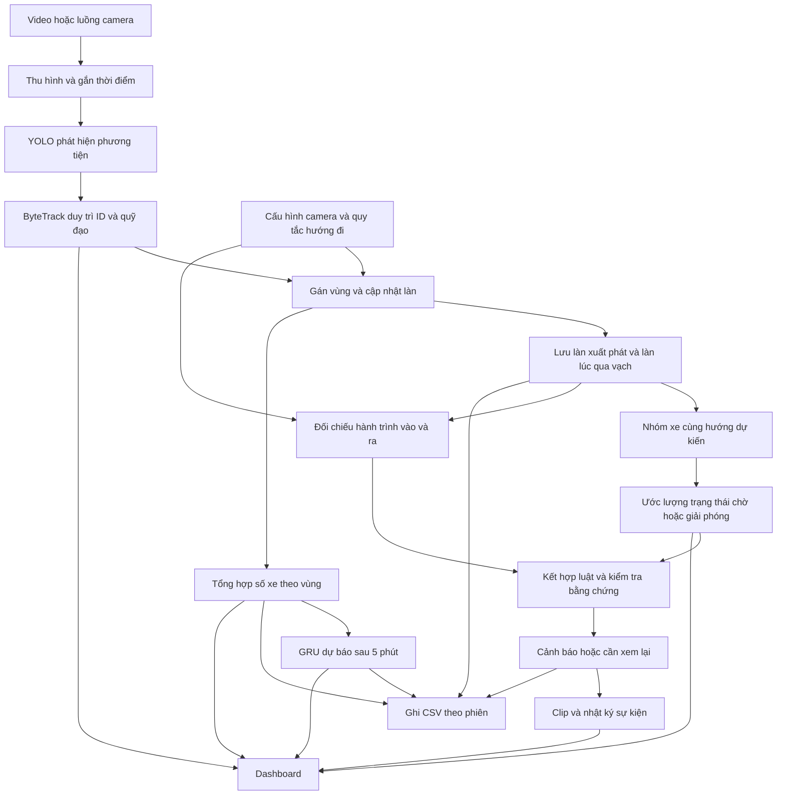

# Pipeline giám sát giao thông tại nút giao

## 1. Mục tiêu và phạm vi

Tài liệu mô tả thiết kế triển khai cho hệ thống theo dõi phương tiện tại camera cố định. Dữ liệu quỹ đạo được dùng đồng thời để cảnh báo hành vi, dự báo số xe hiện diện theo vùng và hiển thị dashboard realtime.

Phạm vi ban đầu là một camera và một nhánh tiếp cận của ngã tư. Mỗi nhánh có thể có nhiều làn. Định danh nhánh và làn phải độc lập để mở rộng sang toàn bộ nút giao.

YOLOv8 và ByteTrack là cấu hình cơ sở. GRU dự báo số xe hiện diện sau 5 phút. Nhánh cảnh báo kết hợp hướng chuyển động, chuỗi cắt vạch và trạng thái dòng xe cùng hướng. Các trường hợp thiếu bằng chứng có trạng thái cần xem lại.

Đây là kế hoạch phát triển. Các mục công việc bên dưới cần được triển khai và kiểm chứng trước khi mô tả là chức năng hoàn thành.

### 1.1 Bài toán và mục tiêu đầu ra

Hệ thống nhận video từ một camera cố định, nhận diện và theo vết từng phương tiện, sau đó tạo hai nhánh phân tích. Nhánh thứ nhất phát hiện hành vi cần rà soát bằng vị trí làn, chuỗi cắt vạch và chuyển động của nhóm cùng hướng. Nhánh thứ hai tạo chuỗi số xe theo vùng để dự báo sau 300 giây. Dashboard trình bày kết quả gắn với thời điểm nguồn và dữ liệu phiên.

| Mục tiêu | Đầu ra kiểm chứng được | Cách đối chiếu |
| --- | --- | --- |
| Theo dõi phương tiện | Bounding box, lớp, ID và quỹ đạo theo thời gian | So với hộp và ID gán nhãn |
| Xác định hành trình | Làn xuất phát, làn lúc vào và nhánh ra | Xem lại video và nhãn qua vạch |
| Hỗ trợ rà soát hành vi | Sự kiện, lý do, trạng thái bằng chứng và clip | Ghép đúng xe, loại sự kiện và thời điểm |
| Dự báo ngắn hạn | Số xe dự báo của từng vùng tại mốc sau 5 phút | So với số đếm tham chiếu tại đích |
| Phản hồi realtime | Trạng thái mới nhất và tuổi của dữ liệu | Đo thời gian nhận, xử lý, phát và hiển thị |

### 1.2 Người dùng và kịch bản sử dụng

Người giám sát chọn nguồn, bắt đầu phiên, quan sát số xe và xem clip của sự kiện được gắn cờ. Nhóm kỹ thuật vẽ vùng và vạch, xác minh hướng lưu thông, lựa chọn cấu hình và kiểm tra nhật ký. Người đánh giá dùng nhãn thủ công để chạy lại video và so sánh các phương pháp trên cùng điều kiện.

Phiên phải hiển thị nguồn đang chạy, cấu hình camera, trạng thái xử lý và thời điểm kết quả mới nhất. Khi mất nguồn hoặc kết quả đã cũ, giao diện trình bày trạng thái đó cùng thời điểm quan sát cuối cùng.

### 1.3 Phạm vi không gian và đối tượng

| Hạng mục | Phạm vi triển khai ban đầu | Điều kiện mở rộng |
| --- | --- | --- |
| Camera | Một camera cố định trong một phiên | Đo bộ nhớ, tải GPU và độ trễ trước khi chạy nhiều nguồn |
| Hình học | Một nhánh vào và các nhánh ra nhìn thấy rõ | Bổ sung cấu hình và nhãn cho các nhánh còn lại |
| Làn | Mỗi nhánh có nhiều đa giác làn và tập làn khả dĩ | Kiểm tra làn dùng chung nhiều hướng và làn bị che |
| Phương tiện | Ô tô, xe máy, xe tải và xe buýt | Bổ sung lớp sau khi có dữ liệu và tiêu chí đánh giá |
| Nguồn thử | Video ghi sẵn phát theo nhịp nguồn | Đánh giá riêng RTSP/HTTP hoặc webcam bằng phiên dài |
| Điều kiện ảnh | Các điều kiện thực sự có trong video được chọn | Giữ riêng tập ban đêm, mưa hoặc camera khác để kiểm thử |

Đa giác làn biểu diễn vùng ảnh dùng cho phân tích. Cấu hình gồm kích thước ảnh nguồn để quy đổi tọa độ khi video đổi độ phân giải. Khi camera xoay hoặc thay góc nhìn, vùng và vạch cần được hiệu chỉnh lại.

### 1.4 Phạm vi hành vi và mức kết luận

| Hành vi | Điều kiện tối thiểu | Kết quả hệ thống |
| --- | --- | --- |
| Đi ngược chiều | Vùng có hướng hợp lệ, quỹ đạo đủ dài và vận tốc vượt ngưỡng nhiễu | Nghi đi ngược chiều, có thời gian duy trì và độ lệch hướng |
| Rẽ sai hướng | Xác định được làn lúc vào, nhánh ra và quy định áp dụng | Nghi rẽ sai hướng hoặc cần xem lại |
| Qua vạch khác nhịp dòng cùng hướng | Nhóm tham chiếu đủ quan sát, đang chờ ổn định, xe được xét cắt vạch | Qua vạch khi dòng cùng hướng đang chờ |
| Nghi vượt đèn đỏ trong đánh giá | Có thêm nhãn tín hiệu đúng hướng tại thời điểm qua vạch | Đối chiếu sự kiện suy luận với tín hiệu tham chiếu |

Quy định rẽ phải được lưu theo nhánh, làn, loại phương tiện và điều kiện áp dụng đã xác minh. Nếu quy định phụ thuộc tín hiệu mà hệ thống chưa quan sát được, kết quả có trạng thái chưa đủ bằng chứng. Dữ liệu số đông chỉ hỗ trợ suy luận trạng thái dòng xe. Nhóm cùng đi qua vẫn có thể cùng vi phạm.

Các cảnh báo nhanh/chậm tương đối và đổi hướng hiện có có thể tiếp tục cung cấp thông tin bổ sung sau khi kiểm tra lại ngưỡng theo camera. Trọng tâm đánh giá của phiên bản này là ngược chiều, hành trình rẽ và qua vạch khi nhóm cùng hướng đang chờ.

### 1.5 Phạm vi công nghệ và trách nhiệm từng module

| Lớp xử lý | Công nghệ cơ sở | Trách nhiệm và lý do lựa chọn |
| --- | --- | --- |
| Thu hình | OpenCV, Python threading và queue | Tách giải mã khỏi suy luận, giới hạn khung chờ để kiểm soát tồn đọng |
| Detection | Ultralytics YOLOv8s và PyTorch | Dùng trọng số đã có, xuất hộp và lớp cho tracker |
| Tracking | ByteTrack | Tạo quỹ đạo theo ID bằng ghép hộp ở các mức tin cậy |
| Hình học làn | OpenCV, NumPy; Supervision khi phù hợp | Kiểm tra điểm trong đa giác, đoạn cắt vạch và hướng di chuyển |
| Luật và trạng thái | Python, NumPy | Lưu hành trình, nhóm xe, thời gian duy trì và lý do cảnh báo |
| Tổng hợp dữ liệu | NumPy trong luồng chạy, Pandas cho xử lý theo lô | Tạo chuỗi đều theo vùng và kiểm tra tệp đầu ra |
| Dự báo | PyTorch GRU | Dự báo theo lịch từ lịch sử đủ chất lượng |
| Dashboard | Streamlit và snapshot dùng chung có khóa ngắn | Hiển thị trạng thái, cảnh báo và dự báo theo chu kỳ làm mới |
| Bằng chứng | Bộ ghi CSV/JSONL và bộ mã hóa clip hiện có | Ghi theo phiên và phản ánh trạng thái xuất bằng chứng |
| Backend tối ưu | TensorRT FP16 hoặc OpenVINO theo thiết bị | Đánh giá giảm thời gian detector cùng sai khác chất lượng |

YOLOv8n và YOLO11n là cấu hình ứng viên khi cần giảm tải. Việc thay detector là một thí nghiệm độc lập với thay bộ luật. Chốt phiên bản thư viện, model, kích thước suy luận và backend trong nhật ký từng phép đo. GRU cũng cần đo thời gian suy luận thực tế trên thiết bị đích để chọn lịch chạy phù hợp.

### 1.6 Logic xử lý một khung hình

1. Nhận khung có ID và timestamp, kiểm tra thứ tự thời gian và khoảng mất nguồn.
2. Thu nhỏ ảnh theo cấu hình, chạy detector và quy đổi hộp về tọa độ nguồn.
3. Cập nhật ByteTrack và lịch sử các ID quan sát được. Ghi chất lượng cho vết mới, mất vết hoặc bước nhảy bất thường.
4. Kiểm tra điểm chân xe trong vùng làn. Cập nhật làn hiện tại sau thời gian ổn định, giữ tập làn khả dĩ tại vùng chồng lấn.
5. Kiểm tra cắt vạch có hướng từ cặp quan sát đủ chất lượng. Chốt làn lúc vào và cập nhật chuỗi sự kiện.
6. Cập nhật đặc trưng nhóm cùng hướng trong cửa sổ quá khứ. Khi chấm một xe, loại xe đó khỏi nhóm tham chiếu.
7. Kết hợp trạng thái nhóm, chuỗi hành trình và luật hướng. Tạo hoặc cập nhật sự kiện theo khóa chống trùng.
8. Cập nhật mẫu số xe trong vùng nếu đến mốc lấy mẫu. Khi đến lịch dự báo, gửi lịch sử cho nhánh GRU.
9. Công bố snapshot và gửi bản ghi cho bộ lưu. Bộ xuất clip nhận yêu cầu cùng thời điểm và ID.

Các bước online chỉ dùng quan sát tại thời điểm hiện tại và quá khứ. Nhánh ra được ghi khi xe thực sự qua vạch ra. Sự kiện có thể được cập nhật trạng thái khi có thêm bằng chứng, kèm thời điểm phát ban đầu và thời điểm xác nhận.

### 1.7 Logic làn và hành trình mơ hồ

Một xe chuyển làn trước nút giao có thể mang `origin_lane` khác `lane_at_entry`. Quy định hướng rẽ được đối chiếu với làn lúc qua vạch đã xác định. Nếu có nhiều làn khả dĩ, áp dụng quy tắc đối chiếu cho từng làn và lưu các kết quả.

- Các làn khả dĩ đều cho phép hành trình thì ghi đủ bằng chứng cho phép.
- Các làn khả dĩ đều cấm cùng hành trình và các mốc đã đủ chất lượng thì phát nghi vấn tương ứng.
- Các khả năng cho kết quả khác nhau thì lưu cần xem lại.
- Thiếu nhánh ra thì giữ hành trình đang diễn ra, vẫn cho phép luật ngược chiều tại nhánh phát cảnh báo khi đủ điều kiện.
- Mất vết kéo dài qua thời điểm cắt vạch thì đánh dấu thiếu bằng chứng và chờ quan sát tiếp.

Nếu bổ sung nối lại ID, cần lưu ID gốc và quan hệ nối để kiểm tra. Việc chuyển trạng thái hành vi sang ID mới đòi hỏi bằng chứng ghép vết đủ rõ và phép đánh giá riêng về gán nhầm xe.

### 1.8 Logic trạng thái dòng xe

Gọi G là tập xe tham chiếu hợp lệ trong vùng tiếp cận của cùng nhóm hướng. G được chọn theo lịch sử quan sát đến thời điểm đang xét và loại xe đang được chấm. Đặc trưng của G gồm số xe, tỷ lệ dừng, tốc độ trung vị, lượt qua vạch và thời gian duy trì.

Tỷ lệ dừng được tính bằng số xe dưới ngưỡng tốc độ dừng chia cho số xe tham chiếu hợp lệ. Nếu mẫu số bằng 0 hoặc số xe thấp hơn mức cấu hình, trạng thái là chưa rõ. Cần xét cả vị trí gần vạch và thời gian dừng để giảm nhầm với xe đỗ hoặc mất theo vết.

Trạng thái chờ yêu cầu nhóm dừng đủ lâu và ít lượt qua vạch. Trạng thái giải phóng yêu cầu nhóm có chuyển động tiến qua vạch được duy trì. Thời điểm khởi hành, dòng bị chắn phía trước và hướng rẽ hỗn hợp có thể dẫn đến trạng thái chưa rõ. Các ngưỡng là tham số cần hiệu chỉnh trên dữ liệu, sau đó cố định trước khi chấm tập kiểm thử.

### 1.9 Logic dự báo và định nghĩa mật độ quan sát

Đích chính là số ID hiện diện tại một mốc trong vùng đã cấu hình, gồm xe đang dừng. Nếu vùng có diện tích hoặc chiều dài mặt đường được hiệu chỉnh, có thể xây dựng thêm đại lượng xe trên đơn vị diện tích hoặc chiều dài và đánh giá riêng.

Đề xuất lấy số đếm mỗi giây và phát dự báo mỗi phút, dựa trên lịch sử 60 giây cho mốc sau 300 giây. Đây là cấu hình khởi đầu để thử, cần đo và lựa chọn lại theo dữ liệu. Với video 3–6 FPS, có thể tạo mẫu mỗi giây từ các quan sát gần mốc và ghi độ phủ.

GRU có đầu vào cơ sở là chuỗi số xe theo vùng. Các đặc trưng mở rộng gồm số xe dừng và lượt vào–ra. Ghi rõ mô hình dùng dữ liệu một vùng hay nhiều vùng, chiều dài lịch sử, nhịp lấy mẫu và quy tắc xử lý thiếu. Mỗi dự báo lưu thời điểm phát, thời điểm đích và phiên bản mô hình. Nhãn tham chiếu tại đích được dùng để chấm sau khi phiên đi tới mốc đó.

### 1.10 Chỉ số đánh giá chất lượng

| Nhóm | Metrics | Cách diễn giải và điều kiện |
| --- | --- | --- |
| Detection | Precision, recall, AP từng lớp, mAP50, mAP50–95 | Ghép hộp theo lớp và IoU, báo cáo số ảnh và số hộp mỗi lớp |
| Tracking | MOTA, MOTP, IDF1, IDSW, phân mảnh | Chấm trên clip có ID liên tục, chỉ rõ vùng và khoảng được gán nhãn |
| Gán làn | Tỷ lệ đúng làn và tỷ lệ chưa rõ | Công bố cả số xe xác định được làn và tổng số xe đủ quan sát |
| Hành trình | Đúng nhánh vào, nhánh ra và hướng rẽ | Chấm theo phương tiện, giữ riêng các hành trình không hoàn chỉnh |
| Cảnh báo | Precision, recall, F1 theo sự kiện | Ghép đúng xe, loại và khoảng thời gian; quy định cảnh báo trùng |
| Định danh sự kiện | Tỷ lệ sự kiện gán đúng phương tiện | Kiểm tra ID trước, trong và sau sự kiện theo phạm vi video thấy được |
| Thiếu bằng chứng | Tỷ lệ cần xem lại và tỷ lệ không kết luận | Công bố trên mọi sự kiện tham chiếu và theo nguyên nhân |
| Dự báo | MAE, RMSE theo vùng | Dùng cùng đích dự báo, cùng nhãn và cùng tập mốc giữa các phương pháp |

Với TP, FP và FN lần lượt là sự kiện đúng, báo sai và bỏ sót, precision bằng TP/(TP+FP), recall bằng TP/(TP+FN), F1 bằng 2TP/(2TP+FP+FN). Mẫu số bằng 0 được báo là chưa xác định.

Với sai số e_i bằng dự báo trừ số đếm thật, MAE bằng trung bình của |e_i| và RMSE bằng căn bậc hai của trung bình e_i². Hai chỉ số cùng đơn vị xe. Cần báo cáo số vùng, mốc thời gian và phiên dùng để tính.

MOTA bằng 1 trừ tổng FN, FP và IDSW chia cho tổng số đối tượng tham chiếu theo khung. IDF1 đánh giá tính nhất quán định danh trên chuỗi. MOTP cần ghi rõ quy ước khoảng cách, ví dụ 1−IoU thì thấp hơn là tốt hơn. Tỷ lệ cần xem lại luôn đi kèm precision/recall để thể hiện mức độ bao phủ của quyết định.

### 1.11 Chỉ số realtime và ngân sách độ trễ

| Mốc | Cách ghi | Mục đích |
| --- | --- | --- |
| Nhận khung | Đồng hồ đơn điệu tại lúc decoder trả khung | Điểm bắt đầu đo trong ứng dụng |
| Kết quả sẵn sàng | Đồng hồ sau detector, tracker và luật | Độ trễ worker |
| Phát cảnh báo | Đồng hồ lúc sự kiện được công bố | Độ trễ tới đầu ra cảnh báo |
| Hiển thị | Dấu xác nhận khi trình duyệt trình bày nếu có đo | Độ trễ tới người dùng |
| Đủ bằng chứng | Timestamp video khi điều kiện luật đã đủ | Tách chờ quan sát khỏi thời gian thực thi |

Độ trễ worker bằng thời gian kết quả sẵn sàng trừ lúc nhận khung. Đo P50, P95 và số mẫu trên từng phiên. Độ trễ sự kiện theo video bằng mốc phát hiện trừ mốc sự kiện gán nhãn. Khi có nội suy, lưu sai số và khoảng quan sát liên quan.

Decoder nhận khung là ranh giới đo trong ứng dụng. Để đo từ camera tới trình duyệt cần timestamp chụp hoặc nguồn tham chiếu đồng bộ và cơ chế xác nhận hiển thị. Với timestamp chụp không có sẵn, báo cáo rõ phạm vi độ trễ đã đo.

Đề xuất cơ sở là giữ hàng đợi một khung, tách xuất clip/CSV và chạy dự báo theo chu kỳ. Đặt mục tiêu số cho P95 sau phép đo cơ sở trên máy đích. Điều kiện xử lý kịp nguồn được đánh giá cùng tốc độ đến, tốc độ lấy mẫu, khung rơi và tuổi snapshot. FPS cao trên video chạy nhanh ngoại tuyến chưa đủ để kết luận độ trễ của phiên realtime.

### 1.12 Dữ liệu thử nghiệm và chống rò rỉ

Tập tracking cần hộp và ID trên đoạn liên tục. Tập hành vi cần làn lúc vào, mốc qua vạch, hướng ra và loại sự kiện. Khi chấm suy luận nghi vượt đèn đỏ, bổ sung nhãn đèn đúng hướng từ video hoặc nguồn tín hiệu đồng bộ. Tập dự báo cần số đếm độc lập tại mốc đích.

Tách video theo phiên, thời gian hoặc camera trước khi chỉnh ngưỡng và tạo cửa sổ huấn luyện. Loại các tệp trùng nội dung khỏi phép chia. Giữ nguyên detector/tracker khi so các bộ luật, giữ cùng mốc đích khi so dự báo. Nếu chỉnh vùng riêng cho camera kiểm thử, ghi rõ đó là cấu hình trước triển khai, đồng thời tránh dùng nhãn sự kiện kiểm thử để tối ưu ngưỡng.

### 1.13 Điều kiện hoàn thành trong phạm vi đồ án

- [ ] Có cấu hình một camera với nhánh và làn tách biệt, hướng đi được xác minh.
- [ ] Phát lại video đúng nhịp nguồn, xuất quỹ đạo và thời điểm đối chiếu được.
- [ ] Ghi được làn lúc vào, vạch qua và nhánh ra cùng trạng thái chưa rõ.
- [ ] Có nhãn và kết quả so sánh luật hiện tại với luật hành trình trên tập giữ riêng.
- [ ] Có cảnh báo liên kết đúng xe và bằng chứng, ghi đầy đủ trạng thái clip.
- [ ] Có nguồn liên tục đủ dài để huấn luyện và chấm dự báo 5 phút.
- [ ] Có bảng GRU so với giữ giá trị cuối và trung bình 60 giây trên cùng mốc.
- [ ] Có kết quả P95 worker, FPS, khung rơi và độ ổn định trên thiết bị đích.
- [ ] Có bảng giới hạn theo nguồn video, độ dài, FPS, số nhãn và số sự kiện.

Mức đóng góp cần chứng minh là tác động của chuỗi qua vạch và xử lý thiếu bằng chứng đối với gán đúng xe, báo sai và độ trễ. Hiệu quả được kết luận theo phạm vi thực nghiệm sau khi hoàn thành các phép chấm.

### 1.14 Phân bổ tài nguyên cho hai nhánh xử lý

Nhánh cảnh báo và nhánh dự báo có lịch chạy khác nhau. Tracking và luật hành vi cần phản hồi khi có khung mới, còn GRU chạy khi tới mốc dự báo. Thiết kế ưu tiên thời gian phản hồi của tracking và cảnh báo, đồng thời giới hạn công việc nền để phiên chạy ổn định.

#### Cấu hình tài nguyên khởi đầu

| Thành phần | Tài nguyên đề xuất | Lịch chạy | Mức ưu tiên |
| --- | --- | --- | --- |
| Thu hình | Luồng CPU và bộ đệm khung | Theo nhịp nguồn | Cao |
| YOLO | GPU NVIDIA nếu phù hợp; OpenVINO trên CPU Intel là phương án đo đối chiếu | Mỗi khung được chọn | Cao nhất |
| ByteTrack và bộ luật | CPU, dùng chung đầu ra YOLO | Sau mỗi lượt phát hiện | Cao nhất |
| Tổng hợp chuỗi số đếm | CPU, NumPy | Khi đến mốc lấy mẫu | Cao, công việc ngắn |
| GRU đã huấn luyện | CPU cho mô hình nhỏ trong cấu hình thử đầu tiên | Theo lịch dự báo, đề xuất mỗi phút | Thấp hơn nhánh cảnh báo |
| Dashboard | Luồng giao diện đọc snapshot | Theo chu kỳ làm mới | Có giới hạn tần suất |
| Ghi CSV và mã hóa clip | Worker nền và bộ đệm giới hạn | Khi có dữ liệu hoặc sự kiện | Có kiểm soát tải |

Đây là cấu hình đề xuất để đo trên máy đích. Số luồng và số tiến trình sẽ được chọn dựa trên kết quả thực nghiệm. Nếu dùng CPU cho cả detector và GRU, cần đo mức tranh chấp tài nguyên trước khi chốt backend và lịch dự báo.

YOLO chỉ chạy một lượt cho mỗi khung được chọn. ByteTrack, bộ luật và tổng hợp số đếm cùng sử dụng đầu ra đó. GRU nhận lịch sử số liệu đã tổng hợp, giúp giảm nhu cầu bộ nhớ và tính toán ảnh của nhánh dự báo.

#### Phân phối dữ liệu và đồng bộ

1. Worker tracking công bố kết quả hiện tại và cập nhật lịch sử số đếm theo vùng.
2. Khi tới lịch, bộ lập lịch sao chép lịch sử và thời điểm gốc cho một yêu cầu GRU.
3. Worker dự báo xử lý bản sao dữ liệu, rồi công bố kết quả kèm `origin_time_s`, `target_time_s`, phiên và phiên bản mô hình.
4. Dashboard đọc snapshot có khóa ngắn và hiển thị tuổi của dữ liệu.
5. Bộ ghi dữ liệu và bộ xuất clip nhận công việc qua hàng đợi có giới hạn.

Khóa chỉ bảo vệ lúc sao chép hoặc cập nhật dữ liệu dùng chung. Các tác vụ suy luận, mã hóa clip và truy cập đĩa thực hiện sau khi nhả khóa. Mỗi worker có trách nhiệm cập nhật trạng thái hoàn thành hoặc lỗi để các nhánh khác tiếp tục hoạt động và người dùng nhận biết phần bị lỗi.

Kết quả dự báo được gắn với phiên tạo ra yêu cầu. Khi người dùng đổi nguồn hoặc khởi tạo phiên mới, kết quả cũ được lưu trong đúng phiên và chỉ được hiển thị nếu còn khớp nguồn đang xem. Việc dừng phiên cần hủy yêu cầu chưa chạy, hoàn tất hoặc kết thúc có kiểm soát công việc đang chạy và đóng bộ ghi dữ liệu.

#### Kiểm soát quá tải

| Hàng đợi | Chính sách đề xuất | Thông tin cần ghi |
| --- | --- | --- |
| Khung chờ suy luận | Một khung chờ, thay bằng khung mới khi đầy | Khung rơi và thời điểm quan sát cuối |
| Yêu cầu dự báo | Một công việc đang chạy và tối đa một yêu cầu chờ mới nhất | Lượt bỏ hoặc thay yêu cầu, thời gian chờ và thời gian suy luận |
| Ghi dữ liệu | Ghi theo lô, bộ đệm giới hạn và flush khi dừng | Lỗi ghi, độ dài hàng đợi và số bản ghi mất nếu có |
| Mã hóa clip | Giới hạn số công việc và số luồng mã hóa | Clip đã lưu, lỗi hoặc bỏ vì bận |

Nếu lượt GRU trước vẫn đang chạy khi đến lịch tiếp theo, giữ tối đa yêu cầu chờ mới nhất và ghi lại các lượt đã gộp hoặc bỏ. Khi lịch sử có khoảng thiếu hoặc quá cũ, công bố chất lượng dự báo tương ứng. Chu kỳ dự báo cần dài hơn đáng kể thời gian suy luận thực đo để tránh tích lũy công việc.

Số luồng tính toán nội bộ của PyTorch, OpenCV và bộ mã hóa có thể làm CPU quá tải dù số worker ít. Đo trên cấu hình mặc định trước, sau đó thử giới hạn số luồng cho GRU hoặc bộ mã hóa nếu chúng làm tăng độ trễ cảnh báo. Việc tách GRU sang tiến trình riêng được xem xét khi kết quả đo cho thấy tranh chấp hoặc nhu cầu cách ly lỗi, có tính tới bộ nhớ và chi phí truyền dữ liệu.

#### Huấn luyện và suy luận GRU

Huấn luyện và tìm siêu tham số thực hiện trong lịch công việc riêng với dữ liệu đã lưu. Phiên realtime nạp mô hình đã được đánh giá và chạy suy luận theo chu kỳ. Giữ phiên bản mô hình và bộ chuẩn hóa cố định trong một phép đo để kết quả có thể tái lập.

Thử GRU trên CPU trước với lịch sử và kích thước mạng dự kiến. Nếu thời gian suy luận gây ảnh hưởng tới lịch cập nhật, so sánh với GPU bằng phép đo toàn hệ thống. Chọn cấu hình đáp ứng đồng thời độ trễ cảnh báo, lịch dự báo và mức sử dụng bộ nhớ trên thiết bị thực tế.

#### Phép đo tác động giữa các nhánh

Chạy cùng video, cấu hình camera, detector và nhịp lấy mẫu ở các chế độ sau.

1. Tracking và cảnh báo để lấy mức cơ sở.
2. Bật thêm tổng hợp chuỗi và GRU theo lịch.
3. Bật đầy đủ dashboard, CSV và xuất clip.

| Nhóm đo | Chỉ số |
| --- | --- |
| Độ trễ nhánh chính | P50/P95 worker và thời gian phát cảnh báo |
| Khả năng theo kịp nguồn | FPS xử lý, khung rơi và tuổi snapshot |
| Nhánh dự báo | Thời gian chờ, thời gian GRU, lượt hoàn thành hoặc bỏ lịch |
| Tài nguyên | CPU, RAM, mức sử dụng GPU và VRAM |
| Tác vụ nền | Độ dài hàng đợi, thời gian mã hóa và trạng thái clip |
| Chất lượng đầu ra | Số đếm, cảnh báo và sai khác do thay đổi khung được xử lý |

Đánh giá mức tăng P95 và khung rơi khi bật từng thành phần. Chạy lặp lại nếu thời gian khởi động hoặc tải máy ảnh hưởng kết quả. Chốt lịch dự báo, backend và giới hạn worker từ phép đo này. Mục tiêu độ trễ số được ghi vào cấu hình đánh giá sau khi có mức cơ sở trên máy đích.

#### Công việc triển khai

- [ ] Đo cấu hình hiện tại khi chỉ chạy tracking và cảnh báo.
- [ ] Thêm lịch GRU và cơ chế lấy bản sao lịch sử có timestamp.
- [ ] Giới hạn yêu cầu chờ và gắn kết quả với đúng phiên.
- [ ] Bổ sung trạng thái worker và số công việc bị bỏ hoặc lỗi.
- [ ] Đo tác động của dashboard, CSV và mã hóa clip lên P95.
- [ ] Thử giới hạn luồng CPU nếu công việc nền tranh chấp với nhánh chính.
- [ ] Kiểm tra dừng phiên, đổi nguồn và hoàn tất bộ ghi khi có công việc đang chạy.

## 2. Sơ đồ kiến trúc

Luồng realtime truyền kết quả trong bộ nhớ. Bộ ghi CSV và bộ mã hóa clip có hàng đợi riêng. Dashboard đọc snapshot để tránh giữ khóa trong lúc suy luận. Mỗi snapshot kèm thời điểm nguồn để người dùng nhận biết kết quả đã cũ.

## 3. Công nghệ sử dụng

| Thành phần | Công nghệ | Vai trò |
| --- | --- | --- |
| Xử lý chính | Python | Quản lý phiên và kết nối các module |
| Đọc và xử lý ảnh | OpenCV | Giải mã, đổi kích thước, kiểm tra hình học |
| Phát hiện | Ultralytics YOLOv8s | Tận dụng trọng số đã tinh chỉnh |
| Theo vết | ByteTrack | Duy trì ID từ hộp phát hiện |
| Hình học và chú thích | OpenCV, Supervision | Đa giác vùng, vạch và lớp chú thích |
| Tính toán | NumPy | Quỹ đạo, tốc độ ảnh và thống kê nhóm |
| Tổng hợp ngoại tuyến | Pandas | Kiểm tra CSV, tạo tập dự báo và báo cáo |
| Dự báo | PyTorch GRU | Học chuỗi số xe theo vùng |
| Dashboard | Streamlit | Video, điều khiển, cảnh báo và dự báo |
| Tối ưu detector | TensorRT FP16 hoặc OpenVINO | Đo trên GPU NVIDIA hoặc CPU Intel tương ứng |

YOLO11n hoặc YOLOv8n là ứng viên so sánh nếu detector hiện tại chậm. Chọn mô hình sau khi đo cả sai số trên xe máy và độ trễ toàn pipeline. Thử xuất và kiểm tra sai khác đầu ra trên phiên bản thư viện đã cài trước khi chọn backend. ByteTrack và bộ luật hình học chủ yếu chạy trên CPU.

## 4. Bước 1 Chuẩn bị dữ liệu và cấu hình camera

### Dữ liệu vào

Video gốc và thông tin camera, độ phân giải, FPS, thời gian ghi hình, nhánh đường, làn, vạch và các hướng được phép.

### Cách thực hiện

Vẽ vùng tiếp cận cho từng làn trước nút giao. Vẽ vạch vào có hướng và các vạch ra tại những vị trí đủ rõ. Mỗi vạch có hai điểm đầu mút, chiều hợp lệ và tên nhánh. Vùng giữa nút giao có thể được cấu hình thành vùng chưa xác định làn.

Định nghĩa bảng hướng đi được phép từ làn lúc qua vạch đến nhánh ra. Bảng này dựa trên quy định thực tế đã xác minh tại camera. Vùng xe có thể đi qua được dùng cho quan sát, còn bảng cho phép được dùng để đánh giá hành trình.

### Đầu ra

Hồ sơ JSON có phiên bản, kích thước ảnh nguồn, `camera_id`, danh sách nhánh, đa giác làn, vạch và bảng hướng đi. Các ID như `north_in_1` là tên kỹ thuật, cần có nhãn tiếng Việt trên giao diện.

### Công việc

- [ ] Chọn video thấy rõ một nhánh vào và các nhánh ra cần chấm.
- [ ] Xác minh hướng đi được phép và điều kiện rẽ phải cho từng nhánh.
- [ ] Vẽ hình học trên kích thước ảnh nguồn và lưu phiên bản cấu hình.
- [ ] Kiểm tra điểm chân xe trên khung hình có chú thích.
- [ ] Phân chia video để chỉnh tham số và video giữ riêng để đánh giá.

## 5. Bước 2 Thu hình và quản lý thời gian

### Cách thực hiện

Luồng thu hình gắn `frame_id`, thời điểm trong video và đồng hồ đơn điệu của hệ thống cho mỗi khung. Video ghi sẵn phát theo nhịp nguồn khi đo realtime. Đánh giá tốc độ xử lý không giới hạn nhịp nguồn phải được ghi thành phép đo riêng.

Hàng đợi xử lý giữ tối đa một khung chờ. Nếu thay khung cũ bằng khung mới, tăng bộ đếm khung rơi. Ghi riêng số khung bỏ chủ động theo cấu hình.

### Công việc

- [ ] Kiểm tra FPS và sự liên tục của timestamp, đặc biệt với video FPS biến thiên.
- [ ] Đo thử chế độ xử lý mọi khung trước khi bật bỏ khung.
- [ ] Dùng độ chênh thời gian thực giữa các quan sát khi tính chuyển động.
- [ ] Ghi khoảng mất nguồn và dừng phiên, bảo đảm vòng đợi kết thúc khi hủy.

Video Hà Nội đã kiểm tra có nguồn khoảng 3–6 FPS. Mốc giữa hai quan sát đã khoảng 167–333 ms trước thời gian xử lý. Thời gian cảnh báo cần được báo cáo theo điều kiện nguồn này.

## 6. Bước 3 Phát hiện và theo vết phương tiện

### Cách thực hiện

YOLO trả hộp bao, độ tin cậy và lớp xe. ByteTrack nối các quan sát theo thời gian. Điểm chân xe là trung điểm cạnh dưới hộp bao, dùng để xét vùng và cắt vạch.

Mỗi ID lưu lịch sử ngắn gồm vị trí và thời điểm để ước lượng hướng, tốc độ ảnh và độ gián đoạn. Khi giảm ảnh trước suy luận, quy đổi hộp về tọa độ ảnh nguồn trước khi xét vùng.

### Đầu ra

Mỗi quan sát gồm ID, lớp chuẩn hóa, hộp bao, điểm chân xe, thời điểm và trạng thái chất lượng. Khóa của đối tượng là tổ hợp `session_id`, `camera_id`, `track_id`.

### Công việc

- [ ] Kiểm tra ánh xạ bốn lớp theo trọng số đã nạp.
- [ ] Gán nhãn ID trên các đoạn xe cắt nhau, xe bị che và xe gần vạch.
- [ ] Theo dõi mất vết, bước nhảy tọa độ và ID mới xuất hiện giữa nút giao.
- [ ] Chặn việc tạo sự kiện cắt vạch từ bước nhảy do gián đoạn quá dài.
- [ ] Đo detector, tracking và độ trễ toàn tuyến trên cùng thiết bị.

## 7. Bước 4 Gán làn và lưu hành trình

### Cách thực hiện

Gán làn khi điểm chân xe nằm ổn định trong vùng tiếp cận qua nhiều quan sát, với điều kiện duy trì theo thời gian. Khoảng duy trì và biên an toàn cần được chọn trên video chỉnh tham số.

Lưu ba thông tin độc lập. `origin_lane` là làn đầu tiên được quan sát ổn định. `current_lane` cập nhật khi xe chuyển làn. `lane_at_entry` được chốt tại lần cắt vạch vào đủ bằng chứng. Trường cuối là căn cứ kiểm tra hướng rẽ.

Nếu điểm nằm trong vùng chồng lấn hoặc sát ranh giới, lưu tập làn khả dĩ và lý do chưa rõ. Khi xe vào vùng giao cắt, giữ lịch sử làn trước đó. Xe xuất hiện lần đầu ở giữa nút giao có làn xuất phát chưa rõ.

### Công việc

- [ ] Xây dựng gán làn có độ ổn định và biên sai số theo phối cảnh.
- [ ] Lưu cả làn khả dĩ và mức bằng chứng.
- [ ] Kiểm tra xe đổi làn trước vạch và xe đi sát ranh giới.
- [ ] Giới hạn bộ nhớ lịch sử, dọn trạng thái khi ID hết hạn.

## 8. Bước 5 Ghi nhận sự kiện qua vạch

### Cách thực hiện

Kiểm tra đoạn nối hai điểm chân xe có cắt đoạn vạch hữu hạn và đổi phía đúng chiều. Có biên chống rung và quy tắc chống ghi lặp. Mỗi sự kiện có thời điểm, mã vạch, chiều cắt và trạng thái chất lượng.

Chuỗi sự kiện cho biết xe vào từ đâu và ra ở đâu. Nội suy thời điểm qua vạch chỉ thực hiện khi hai quan sát liên tiếp đủ tin cậy. Lưu khoảng bất định theo hai thời điểm quan sát để chấm sai số thời gian trên nguồn FPS thấp.

### Công việc

- [ ] Kiểm tra đoạn vạch hữu hạn, xe chạm vạch rồi quay lại và xe dừng trên vạch.
- [ ] Chống ghi lặp theo ID, vạch và lượt đi qua.
- [ ] Giữ sự kiện có làn chưa rõ để rà soát.
- [ ] Phân biệt phép đếm một lần theo ID hiện có với chuỗi nhiều vạch của hành trình mới.

## 9. Bước 6 Ước lượng trạng thái dòng xe

### Cách thực hiện

Tạo nhóm tham chiếu ở gần vạch, cùng nhánh và hướng dự kiến có cùng điều kiện dừng–đi. Loại chính xe đang được xét khỏi nhóm tham chiếu. Với làn dùng chung nhiều hướng, giữ hướng chưa rõ cho tới khi đủ bằng chứng.

Tính số xe quan sát hợp lệ, tỷ lệ dừng, tốc độ trung vị, số lượt qua vạch trong cửa sổ gần nhất và thời gian trạng thái duy trì. Đầu ra gồm `waiting`, `releasing`, `unknown`. Dùng ngưỡng vào và ngưỡng thoát khác nhau để giảm nhấp nháy trạng thái.

Đo tốc độ bằng px/s khi chưa hiệu chỉnh mặt đường. Nhóm xe cần đủ gần để giảm sai khác phối cảnh. Khi có quá ít xe, mất quan sát hoặc không rõ nhóm hướng, trạng thái là `unknown`.

### Công việc

- [ ] Định nghĩa vùng hàng chờ và vùng đối chiếu ở mỗi nhánh.
- [ ] Chọn cửa sổ và số xe tối thiểu trên tập chỉnh tham số.
- [ ] Gán nhãn các đoạn chuyển pha, ùn tắc và nhóm cùng đi qua.
- [ ] Lưu đặc trưng nhóm cùng số xe tham chiếu để giải thích cảnh báo.

## 10. Bước 7 Đối chiếu hành vi và tạo cảnh báo

### Các luật dự kiến

| Sự kiện | Bằng chứng cần có | Thời điểm có thể kết luận |
| --- | --- | --- |
| Nghi đi ngược chiều | Hướng đối nghịch trong nhánh có hướng hợp lệ, tốc độ tối thiểu và duy trì đủ thời gian | Khi đủ chuỗi quan sát trong nhánh |
| Nghi rẽ sai hướng | Làn lúc vào và nhánh ra xác định, cặp chuyển tiếp bị cấm trong cấu hình | Khi nhận diện được nhánh ra |
| Qua vạch khi dòng cùng hướng đang chờ | Sự kiện qua vạch và nhóm tham chiếu đủ tin cậy ở trạng thái chờ | Khi cắt vạch và đủ bằng chứng trạng thái |
| Cần xem lại | Làn mơ hồ, hướng chưa rõ, khoảng mất vết hoặc quy định chưa xác minh | Khi phát hiện thiếu bằng chứng |

Hành vi của số đông được dùng như tín hiệu ngữ cảnh. Nhóm xe cùng đi có thể cùng vi phạm, còn xe đi riêng có thể rẽ theo hướng được phép. Với mục tiêu kiểm chứng nghi vượt đèn đỏ, tập đánh giá cần trạng thái đèn đúng hướng được gán nhãn độc lập tại thời điểm cắt vạch.

Khi nhiều làn đầu vào khả dĩ dẫn tới kết luận khác nhau, chuyển sự kiện sang cần xem lại. Khi các khả năng đều phù hợp cùng kết luận, lưu kết luận cùng tập khả năng và bằng chứng. Một sự kiện có khóa chống trùng và có thể cập nhật từ chờ xác minh sang đã đủ bằng chứng.

### Công việc

- [ ] Tận dụng luật ngược chiều hiện có sau khi kiểm tra hình học camera.
- [ ] Triển khai bảng hướng đi theo làn vào và nhánh ra.
- [ ] Lưu lý do kích hoạt, mức bằng chứng và phiên bản cấu hình.
- [ ] Chấm riêng rẽ phải, xe chuyển làn, nhóm cùng vi phạm và xe xuất hiện giữa nút.
- [ ] Tránh dùng giả định xe tuân thủ để loại đối tượng ngay trong bước tracking.

## 11. Bước 8 Tổng hợp chuỗi và dự báo GRU

### Cách thực hiện

Lấy mẫu số ID đang quan sát trong mỗi vùng theo khoảng đều. Số xe hiện diện gồm xe dừng. Xe mất quan sát có trạng thái chất lượng riêng. Giữ riêng lượt vào và lượt ra trong từng khoảng để làm đặc trưng bổ sung nếu cần.

Tập dự báo cơ sở dùng lịch sử số xe vùng đích. Bản mở rộng có thể thêm số xe đang dừng, lượt vào–ra và số xe ở vùng tiếp cận. GRU dự báo số xe hiện diện tại mốc sau 300 giây. Nhịp tổng hợp, độ dài lịch sử và nhịp dự báo được khai báo tường minh trong cấu hình thí nghiệm.

Chia phiên hoặc thời gian trước khi tạo cửa sổ. Huấn luyện scaler trên tập train, dùng cùng scaler cho validation và test. Giữ thời điểm đích của tập train trước phần đánh giá. So sánh GRU với giữ giá trị cuối và trung bình 60 giây trên cùng mốc đích.

### Công việc

- [ ] Chuẩn hóa khoảng lấy mẫu và định nghĩa vùng cần dự báo.
- [ ] Đánh dấu khoảng thiếu dữ liệu thay vì ghi bằng 0.
- [ ] Thu video liên tục đủ lịch sử và thời gian tới đích dự báo.
- [ ] Video một phút hiện có phục vụ tracking và luật; dự báo 5 phút cần nguồn liên tục dài hơn.
- [ ] Chạy dự báo theo lịch trong worker riêng, tránh chặn tracking.
- [ ] Báo cáo MAE/RMSE theo vùng, số mốc đích và nhiều lần khởi tạo GRU.

## 12. Bước 9 Lưu dữ liệu và bằng chứng

Các bảng dưới đây là hợp đồng dữ liệu đề xuất. Khi triển khai, ánh xạ với đầu ra hiện có và lưu phiên bản lược đồ.

| Tệp | Trường chính |
| --- | --- |
| `tracks.csv` | `session_id, camera_id, frame_id, video_time_s, track_id, class_name, x1, y1, x2, y2, foot_x, foot_y, confidence, quality` |
| `lane_states.csv` | `session_id, video_time_s, track_id, approach_id, origin_lane, current_lane, lane_at_entry, candidate_lanes, quality` |
| `crossings.csv` | `session_id, event_id, video_time_s, track_id, line_id, direction, uncertainty_s, quality` |
| `group_states.csv` | `session_id, video_time_s, group_id, peer_count, stopped_ratio, median_speed, crossing_count, state` |
| `alerts.csv` | `session_id, event_id, video_time_s, track_id, event_type, status, reason, config_version, clip_path, clip_status` |
| `zone_counts.csv` | `session_id, video_time_s, zone_id, total, stopped, incoming, outgoing, coverage, quality` |
| `forecasts.csv` | `session_id, origin_time_s, target_time_s, zone_id, predicted_total, model_version, quality` |

Với vùng chồng lấn, phải quy định rõ vùng đo loại trừ nhau hoặc có thể đếm trùng, rồi thể hiện ý nghĩa trên dashboard. Tổng số toàn khung dùng tập ID duy nhất.

Giữ luồng ghi có thứ tự, flush theo lô và hoàn tất khi dừng phiên. Ghi lại số bản ghi mất nếu hàng đợi đầy. Bộ mã hóa clip không chặn luồng cảnh báo. CSV sự kiện có trạng thái clip để nhận biết xuất thành công hoặc lỗi. Dữ liệu phiên lưu thêm mã mô hình, tham số, thông tin nguồn và bản sao cấu hình camera.

## 13. Bước 10 Dashboard

Dashboard trình bày video có ID, vùng và vạch; số xe theo vùng; trạng thái nhóm; cảnh báo cùng lý do; clip bằng chứng; dự báo và các chỉ số vận hành. Hiển thị trạng thái chưa rõ để tránh biến dữ liệu thiếu thành kết luận chắc chắn.

### Công việc

- [ ] Điều khiển chọn nguồn, cấu hình và bắt đầu hoặc dừng phiên.
- [ ] Đọc snapshot có giới hạn tần suất, tránh dựng lại mô hình khi giao diện làm mới.
- [ ] Cho lọc cảnh báo theo xe, thời gian và trạng thái bằng chứng.
- [ ] Thể hiện thời điểm nguồn và độ cũ của kết quả.
- [ ] Tách FPS nguồn, FPS xử lý, khung bỏ chủ động và khung rơi trên phần theo dõi vận hành.

## 14. Đánh giá và câu hỏi nghiên cứu

### Chất lượng

| Phần | Chỉ số và nhãn cần có |
| --- | --- |
| Detection | AP từng lớp và mAP, nhãn hộp tham chiếu |
| Tracking | IDF1, ID switches, MOTA/MOTP trên chuỗi có nhãn ID |
| Gán làn và hành trình | Đúng làn lúc vào, đúng nhánh ra, tỷ lệ chưa rõ, gán đúng xe |
| Cảnh báo | TP/FP/FN theo sự kiện, precision/recall, sai số thời điểm, tỷ lệ cần xem lại |
| Dự báo | MAE/RMSE theo vùng và mốc đích, đối chiếu các phương pháp cơ sở |

Quy định trước cách ghép cảnh báo với xe và cửa sổ nhãn, cách xử lý cảnh báo trùng và sự kiện chưa kết luận. Báo cáo kết quả trên mọi sự kiện cùng kết quả trên tập đã đủ bằng chứng. Với MOTP, công bố khoảng cách được dùng và chiều tốt hơn.

### Độ trễ

Ghi các mốc nhận khung, xử lý xong, phát cảnh báo và trình bày trên dashboard. Tách thời gian đợi đủ bằng chứng hành vi khỏi thời gian thực thi. Đo độ trễ phát cảnh báo trên đồng hồ hệ thống, còn thời điểm sự kiện gốc dùng đồng hồ video. Thời gian mã hóa clip được báo cáo riêng.

Mục tiêu độ trễ cần chốt sau phép đo cơ sở trên thiết bị đích. Báo cáo trung vị, P95, số khung rơi, RAM và VRAM của phiên dài, kèm nhịp lấy mẫu.

### Thí nghiệm đóng góp chính

1. Luật góc hiện có làm mốc cho ngược chiều.
2. Luật chuỗi qua vạch với gán cứng một làn.
3. Luật chuỗi qua vạch có tập làn khả dĩ và trạng thái cần xem lại.

Giữ cùng video, đầu ra detector/tracker và nhịp lấy mẫu để so phần luật. Với rẽ sai hướng, so cấu hình 2 và 3 theo nhãn thủ công. Phân tích riêng xe rẽ hợp lệ, xe đi sai hướng, xe sát ranh giới, mất ID và ùn tắc. Tuyên bố đóng góp dựa trên chênh lệch đo được và điều kiện thử.

## 15. Trình tự triển khai

| Giai đoạn | Công việc | Điều kiện chuyển bước |
| --- | --- | --- |
| 1 | Chọn camera, gán nhãn thử, vẽ một nhánh vào và vạch ra | Video đủ quan sát hành trình và quy định hướng đi đã xác minh |
| 2 | Chạy tracking, lưu CSV và đo thời gian cơ sở | ID và timestamp đối chiếu được với video |
| 3 | Gán làn và ghi sự kiện qua vạch | Xem lại từng sự kiện trên video, bao gồm ca mơ hồ |
| 4 | Ước lượng trạng thái nhóm và luật hành trình | Có cảnh báo kèm lý do, xử lý thiếu bằng chứng |
| 5 | Thêm snapshot dashboard và bằng chứng | Dừng phiên an toàn, clip và CSV liên kết đúng |
| 6 | Thu video dài, tổng hợp chuỗi và thử GRU | Tập train/test tách theo phiên hoặc thời gian |
| 7 | Tối ưu backend và so sánh cấu hình | Đánh giá lại cả chất lượng và P95 trên cùng nguồn |

## 16. Liên hệ mã nguồn hiện có

| Vị trí | Phần có thể tái sử dụng | Việc cần đối chiếu khi triển khai |
| --- | --- | --- |
| `src/realtime.py` | Phiên xử lý, luồng đọc, hàng đợi một khung, snapshot và dự báo cơ sở | Bổ sung trạng thái làn/hành trình và lịch dự báo GRU |
| `src/traffic_analytics.py` | Vùng, hướng, tốc độ, luật theo quỹ đạo và cổng vào/ra | Mở rộng nhiều làn khả dĩ, chuỗi cắt vạch và trạng thái nhóm |
| `src/alert_evidence.py` | Xuất clip và trạng thái mã hóa | Thống nhất khóa sự kiện và cập nhật trạng thái cần xem lại |
| `src/forecasting.py` | Mô hình chuỗi và huấn luyện | Kiểm tra đặc trưng, scaler và chân trời dự báo theo lược đồ mới |
| `app/components/` | Giao diện realtime, phân tích và cảnh báo | Hiển thị làn, lý do cảnh báo và độ cũ snapshot |
| `evals/` | Phát lại và chấm kết quả | Bổ sung nhãn hành trình và các trường hợp chưa rõ |

Tài liệu `DATA_CONTRACT.md` hiện mô tả tổng hợp ID theo khoảng 5 phút phục vụ một luồng khác. Trước khi triển khai pipeline mới, cần thống nhất hợp đồng dữ liệu để phân biệt số xe hiện diện, lượt qua vạch và số ID xuất hiện trong một khoảng. Các đại lượng đó cần tên cột, nhãn giao diện và phép đánh giá riêng.

## 17. Phân tích tái sử dụng và công việc phát triển tiếp

Phân tích này dựa trên mã nguồn được đọc trong phiên rà soát. Chức năng được liệt kê là có nền triển khai, cần chạy lại trên dữ liệu nút giao trước khi xác nhận phù hợp với pipeline mới. Các đầu việc mở rộng dưới đây là kế hoạch.

### 17.1 Bản đồ module tái sử dụng

| Module hiện có | Nền có thể tái sử dụng | Giới hạn liên quan đến thiết kế mới | Công việc tiếp theo |
| --- | --- | --- | --- |
| [realtime.py](../src/realtime.py) | `RealtimeSession`, luồng thu hình, hàng đợi một khung, snapshot, bỏ khung, khung rơi và telemetry | Nhánh dự báo đang tính trung bình 60 giây trong vòng xử lý. Việc ghi telemetry cũng nằm trong vòng này | Đưa GRU vào worker theo lịch, giới hạn yêu cầu chờ, tách ghi nếu phép đo xác định nghẽn I/O và bổ sung tuổi snapshot |
| [traffic_pipeline.py](../data/goi_ban_giao_B/src/traffic_pipeline.py) | Detector, ByteTrack, hộp bao, ID, quỹ đạo, đếm qua vạch và luật ngược chiều theo hình học cũ | Hình học và tham số luật gắn với góc quay bàn giao. Chất lượng trọng số trên camera Hà Nội chưa được xác nhận bởi việc tái sử dụng | Kiểm tra checkpoint và ánh xạ lớp, chấm mẫu nút giao, tách cấu hình góc quay khỏi dữ liệu mới, lưu phiên bản tracker |
| [traffic_analytics.py](../src/traffic_analytics.py) | Kiểm tra hồ sơ camera, đa giác, hướng, homography và điểm chân xe | `region()` lấy đa giác đầu tiên chứa điểm, chưa trả tập làn khả dĩ | Thêm lớp gán làn có độ ổn định, tập ứng viên và biên mơ hồ. Giữ quy ước vùng đếm rõ ràng khi nhiều đa giác chồng nhau |
| [traffic_analytics.py](../src/traffic_analytics.py) | Lịch sử theo ID, tốc độ từ khớp tuyến tính, hướng, trạng thái gap/jump và thời gian duy trì | Chưa có trạng thái riêng cho làn xuất phát và làn lúc cắt vạch | Bổ sung `origin_lane`, `current_lane`, `lane_at_entry`, hướng dự kiến và độ tin cậy của hành trình |
| [traffic_analytics.py](../src/traffic_analytics.py) | Ghi cổng vào/ra và `movements` | Cổng hiện là vùng đa giác. Một hành trình có trạng thái hoàn tất theo cơ chế hiện có | Thêm sự kiện cắt vạch hữu hạn có hướng, chống rung, khoảng bất định thời gian và chuỗi nhiều mốc |
| [traffic_analytics.py](../src/traffic_analytics.py) | Ngược chiều theo vùng, đổi hướng đột ngột, tốc độ nhanh/chậm tương đối | Các luật chưa đối chiếu bảng hành trình được phép và chưa có nhóm chờ–giải phóng | Thêm luật hành trình và cơ chế cập nhật bằng chứng theo cùng sự kiện |
| [traffic_analytics.py](../src/traffic_analytics.py) | Chọn xe đối chiếu theo vùng, lớp, hướng và khoảng cách | Bộ chọn đang phục vụ so tốc độ. Hướng của xe đứng yên có thể thiếu và lớp xe khác nhau vẫn có thể cùng chịu một tín hiệu | Tạo nhóm tham chiếu riêng cho trạng thái dòng xe, dùng lịch sử hướng và vị trí làn. Cho phép nhiều lớp xe khi cùng nhóm hướng, loại xe đang xét và lưu số mẫu |
| [gate_discovery.py](../src/gate_discovery.py) | Đề xuất cổng từ phân cụm đầu/cuối quỹ đạo để người dùng kiểm tra | Yêu cầu vết đủ hoàn chỉnh và ít gián đoạn, có ngưỡng 14 quan sát và lấy 7 điểm ở mỗi đầu. Nguồn 3–6 FPS có thể làm các điều kiện này loại nhiều vết | Đánh giá lại ngưỡng theo thời gian và FPS, ghi tỷ lệ vết bị loại. Người dùng xác nhận cổng và hướng hợp lệ |
| [alert_evidence.py](../src/alert_evidence.py) | Bộ đệm ảnh, worker mã hóa, hàng đợi giới hạn, CSV và trạng thái clip | Chưa có đầy đủ trường làn, lý do mơ hồ và vòng đời cập nhật sự kiện mới | Mở rộng lược đồ sự kiện, lưu thời điểm phát và xác nhận. Kiểm tra phụ thuộc encoder và hành vi khi hàng đợi đầy |
| [forecasting.py](../src/forecasting.py) | `TrafficRNN` hỗ trợ GRU/LSTM, phương pháp cơ sở và hàm sai số | Các giá trị mặc định và mô tả cũ theo lưu lượng cần được đối chiếu với số xe hiện diện. MAPE hiện bỏ mẫu bằng 0 và trả 0 khi toàn bộ nhãn bằng 0 | Khai báo rõ feature/horizon, lưu scaler và model, dùng MAE/RMSE làm chỉ số chính. Nếu giữ MAPE, công bố số mẫu hợp lệ và quy ước trường hợp thiếu mẫu |
| [forecast_replay.py](../evals/forecast_replay.py) | Lịch sử 60 giây, đích 300 giây, chia theo thời gian và so giữ giá trị cuối/trung bình/GRU | Phép thử hiện có ít mốc đích, dùng một chuỗi camera cũ | Tái dùng khung chấm trên nguồn dài mới, kiểm tra độ phủ và thêm nhiều lần khởi tạo, phiên kiểm thử |
| [forecast_truth.py](../src/forecast_truth.py) | Đọc nhãn số đếm và đối chiếu mốc dự báo | Cần xác nhận quy ước ghép giây và vùng khi nguồn có timestamp không đều | Ghi khoảng cách thời gian ghép, kiểm tra vùng và từ chối nhãn thiếu căn cứ |
| [tracking.py](../src/tracking.py) | Đọc và kiểm tra CSV, tổng hợp ID theo khoảng | Đại lượng distinct ID trong khoảng khác với số xe tại một mốc. Phép chọn lớp ngoại tuyến có thể dùng toàn bộ phiên | Tái sử dụng kiểm tra dữ liệu, xây phép tổng hợp hiện diện riêng và dùng lựa chọn lớp chỉ dựa quá khứ cho online |
| [score_realtime.py](../evals/score_realtime.py) | Ghép hộp theo IoU, tính IDF1 và ID switches trên nhãn, ghép cảnh báo theo đúng xe | Chấm các khung đã gán nhãn. Chưa cung cấp đầy đủ MOTA/MOTP theo chuỗi và nhãn hành trình mới | Thêm bộ chấm chuỗi liên tục, quy ước ignore/ROI và nhãn làn/vạch, đo sự kiện chưa kết luận |
| [realtime_benchmark.py](../evals/realtime_benchmark.py) và [metrics.py](../evals/metrics.py) | Chạy cấu hình đối chiếu, tổng hợp FPS/P95 và sai số | Độ trễ worker chưa bao quát phần hiển thị trình duyệt | Bổ sung đo tới đầu ra cần đánh giá, thời gian chờ bằng chứng và tác động khi bật GRU/clip |
| [app/components](../app/components) | Video, điều khiển phiên, bảng cảnh báo, biểu đồ vùng, dự báo và cấu hình | Chưa trình bày đầy đủ trạng thái làn và dòng cùng hướng | Thêm overlay làn, trạng thái nhóm, lý do cảnh báo, tuổi dữ liệu và trạng thái cần xem lại |

### 17.2 Ranh giới phát triển khi tái sử dụng

`RealtimeSession` tiếp tục quản lý phiên và điều phối dữ liệu. Detector/tracker cung cấp quan sát. `TrafficAnalytics` cung cấp phép đo chuyển động và luật hiện có. Phần gán làn, chuỗi cắt vạch và trạng thái dòng xe cần có trách nhiệm rõ để tránh ghép mọi quyết định vào cùng một vòng lặp lớn.

Có thể bắt đầu bằng các hàm hoặc thành phần nhỏ trong module hiện có. Khi trạng thái và cách kiểm thử đã rõ, tách module theo trách nhiệm nếu giúp mã dễ đọc và dễ kiểm tra. Mỗi bước mở rộng cần chạy qua đường vào realtime đang sử dụng, với cấu hình camera được nạp từ giao diện.

### 17.3 Phụ thuộc giữa các công việc

| Thứ tự | Công việc | Phụ thuộc | Bằng chứng hoàn thành |
| --- | --- | --- | --- |
| 1 | Đo lại detector/tracker và nguồn thời gian trên clip mới | Video và thiết bị đích | Quỹ đạo, nhãn mẫu và báo cáo cơ sở |
| 2 | Mở rộng lược đồ camera và dữ liệu phiên | Quy định hướng đi đã xác minh | Hồ sơ hợp lệ, phiên bản và overlay |
| 3 | Gán làn và ghi vạch có hướng | Quan sát tracking, hồ sơ camera | Chuỗi sự kiện đối chiếu được với video |
| 4 | Nhóm xe và trạng thái dừng–đi | Làn, hướng lịch sử và sự kiện qua vạch | Đặc trưng nhóm, nhãn trạng thái và ca chưa rõ |
| 5 | Luật hành trình và cập nhật bằng chứng | Bảng hướng đi, chuỗi sự kiện, chất lượng vết | Cảnh báo có lý do, ID và vòng đời trạng thái |
| 6 | Mở rộng clip, CSV và dashboard | Lược đồ sự kiện ổn định | Liên kết đúng sự kiện–clip, trạng thái lỗi được hiển thị |
| 7 | Tích hợp GRU theo lịch | Chuỗi số đếm dài và mô hình đã đánh giá | Dự báo theo phiên, target và scaler xác định |
| 8 | So sánh bộ luật và đo tải toàn tuyến | Nhãn giữ riêng và các thành phần đã tích hợp | Bảng chất lượng, độ bao phủ, P95 và tài nguyên |

Thu video dài cho GRU có thể thực hiện trong lúc phát triển luật. Kết luận về lợi ích của bộ luật cần giữ cùng đầu ra tracking. Kết luận về tối ưu detector cần thêm phép đo ảnh hưởng tới đầu ra tracking và cảnh báo.

### 17.4 Các lỗi tương thích cần phòng ngừa

- Hợp đồng dữ liệu cần thống nhất lớp nội bộ `xe_hoi`, `xe_may`, `xe_tai`, `bus` với tên chuẩn dùng trong CSV. Lưu ánh xạ rõ ở điểm chuyển đổi.
- Timestamp tính bằng giây video và đồng hồ đo thời gian thực thi phải có tên trường rõ. Các phép duy trì hành vi dùng thời gian video hoặc thời điểm chụp được xác định nhất quán.
- Cấu hình cũ có `zones`, `entry_gates` và `exit_gates` cần được đọc có phiên bản. Nếu thiếu làn/vạch mới, chỉ kích hoạt các chức năng đủ cấu hình và hiển thị trạng thái tính năng.
- Một hàng telemetry có thể chứa quan sát khác với một mẫu số đếm theo giây. Quy định cách lấy mẫu và thời gian gần nhất được chấp nhận trước khi đưa vào GRU.
- Khoảng mất ID phải làm gián đoạn bằng chứng duy trì và chuỗi qua vạch theo quy tắc đã định. Chuyển trạng thái qua quan hệ nối ID chỉ thực hiện khi quan hệ đó đã được kiểm tra.
- Cơ chế đếm một lần cho mỗi ID ở vạch cũ cần tách khóa khỏi chuỗi nhiều vạch mới để tránh bỏ mất nhánh ra.
- Mỗi lần đổi nguồn hoặc reset tracker tạo phiên hoặc thế hệ ID mới. Kết quả GRU, clip và dữ liệu ghi phải giữ khóa phiên đúng.
- Kiểm tra bộ mã hóa bằng một clip ngắn trước khi chạy phiên đánh giá. Lỗi encoder phải có trạng thái và thông tin chẩn đoán.

### 17.5 Phép kiểm tra khi mở rộng

Các test hiện có trong [tests](../tests) và [evals/test_metrics.py](../evals/test_metrics.py) là nền kiểm tra. Khi thay hành vi, bổ sung các trường hợp mà test hiện tại chưa bao phủ.

| Nhóm | Trường hợp cần kiểm tra |
| --- | --- |
| Gán làn | Sát biên, vùng chồng, đổi làn, xe xuất hiện giữa nút |
| Qua vạch | Cắt ngoài đoạn hữu hạn, chạm vạch, rung, hai chiều và khoảng mất vết |
| Nhóm xe | Nhóm rỗng, ít xe, khác lớp cùng hướng, xe mục tiêu bị loại khỏi tham chiếu |
| Luật hành trình | Rẽ hợp lệ, rẽ cấm, nhiều làn cho kết luận khác nhau và thiếu nhánh ra |
| Vòng đời | Reset ID, đổi nguồn, dừng khi GRU hoặc encoder còn chạy |
| Dự báo | Thiếu giây, nhãn sai vùng, target chưa tới và scaler chỉ fit train |
| Hiệu năng | Hàng đợi đầy, clip phát sinh dồn, GRU chậm và snapshot cũ |

Kiểm tra đơn vị xác nhận tính đúng của hình học và trạng thái. Nhãn video kiểm tra chất lượng theo dữ liệu thực. Benchmark trên máy đích xác nhận tác động realtime. Ba loại bằng chứng này cùng cần thiết khi kết luận khả năng tái sử dụng.

### 17.6 Phạm vi triển khai đầu tiên được đề xuất

Tái sử dụng phiên realtime, YOLO/ByteTrack, tốc độ ảnh, luật hướng và bộ xuất bằng chứng. Xây phần gán làn cùng chuỗi cắt vạch trước, sau đó thêm bảng hướng rẽ và trạng thái nhóm. GRU tiếp tục được đánh giá ngoại tuyến khi thu dữ liệu dài, rồi tích hợp worker theo lịch sau khi có mô hình lưu/nạp được.

Mục tiêu của lần triển khai đầu là một nhánh vào có hành trình và cảnh báo kiểm tra được. Sau khi đo độ bao phủ, gán đúng xe và P95, mở rộng sang nhánh tiếp theo. Việc đã có module cơ sở giúp giảm công triển khai, còn mức chất lượng trên ngã tư mới được xác định bằng các phép chấm nêu trên.
